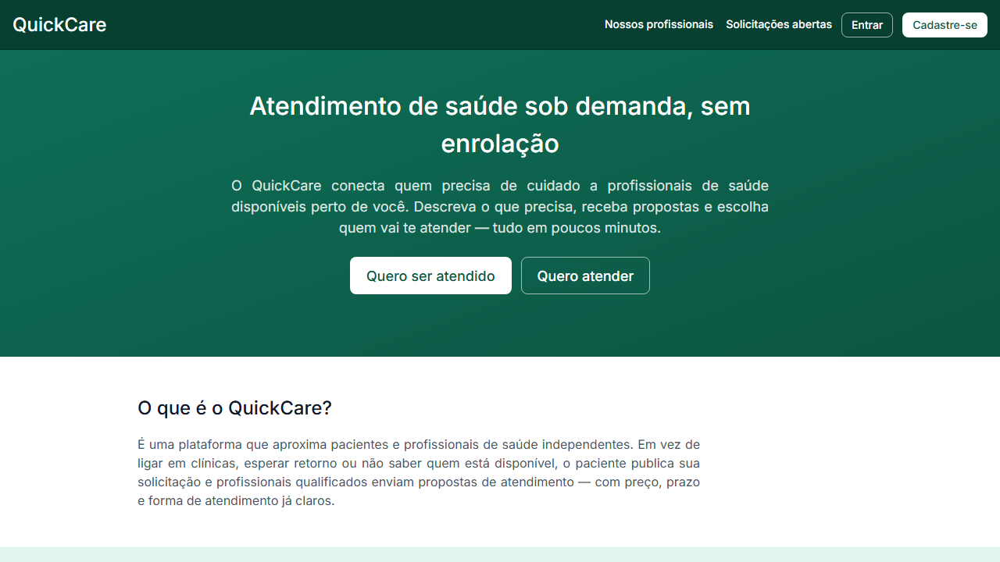
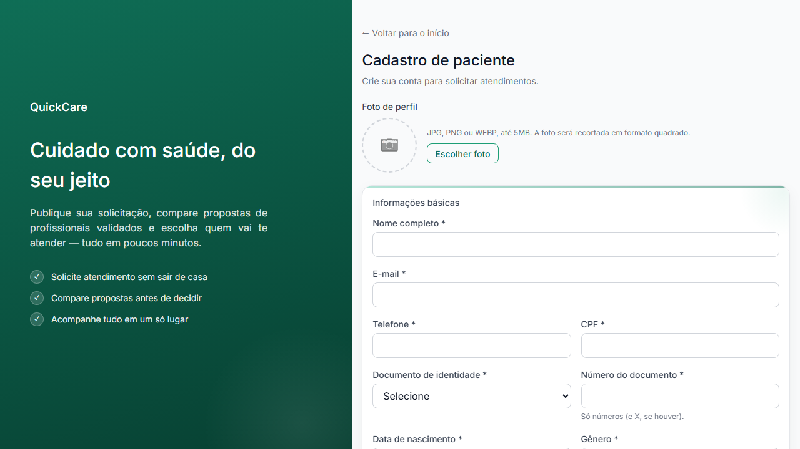
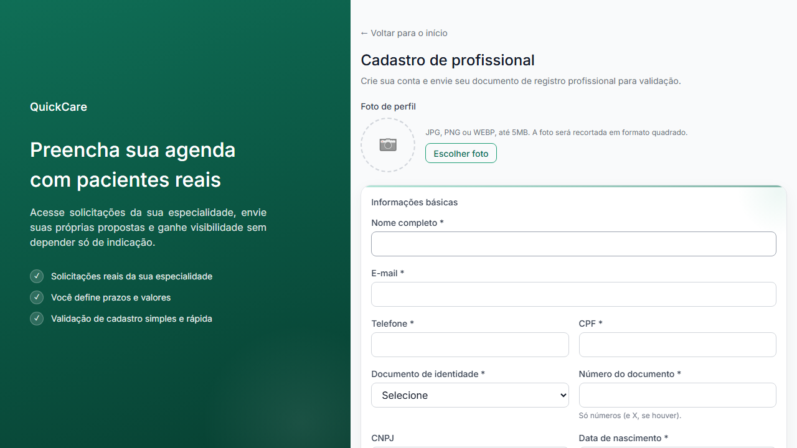
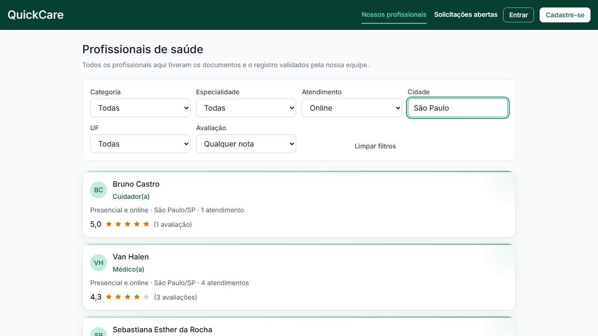
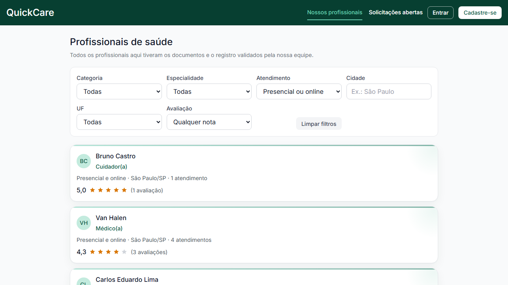
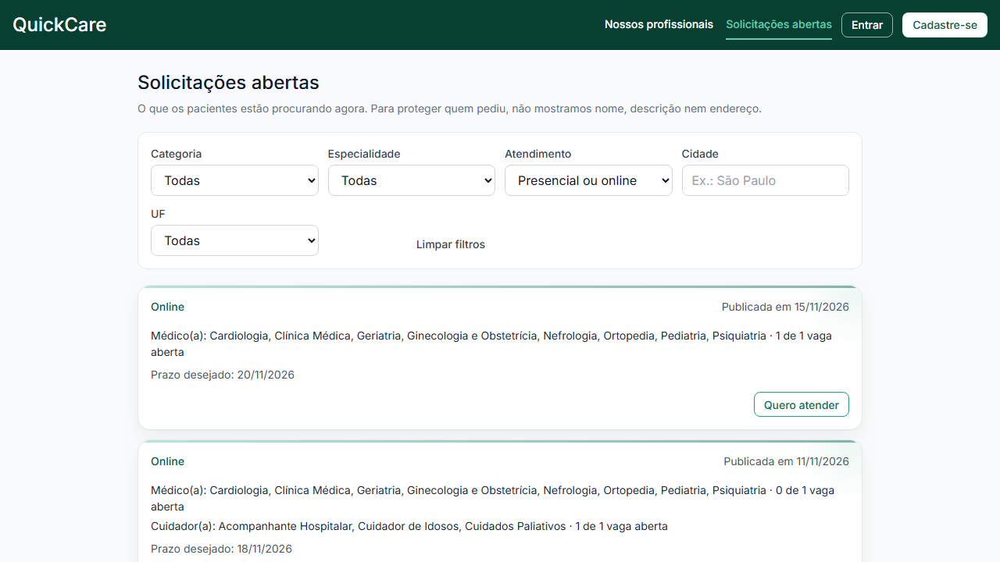

# Relatório de Execução de Testes End-to-End (E2E) — Teste 01

## 1. Identificação e Metadados da Execução

| Campo | Detalhamento |
| :--- | :--- |
| **Suíte de Teste** | `01 - Vitrine Pública e Navegação Inicial (@smoke)` |
| **Arquivo de Especificação** | `e2e/tests/01-publico-e-navegacao.spec.ts` |
| **Data da Execução** | `15/11/2026` |
| **Horário de Início (BRT / UTC-3)** | `20:19:20` (`2026-11-15T23:19:20.297Z`) |
| **Horário de Término (BRT / UTC-3)** | `20:19:48` (`2026-11-15T23:19:48.956Z`) |
| **Duração Total da Bateria** | `28,66 s` (`28.659 ms`) |
| **Ambiente Alvo (Frontend)** | Produção / Remoto — `https://quickcare-frontend.vercel.app` |
| **Ambiente Alvo (API Backend)** | Produção / Remoto — `https://quickcare-backend-b4a4.onrender.com` |
| **Ferramenta / Motor** | Playwright (`@playwright/test`) + TypeScript — Projeto `chromium-remote` (Chrome Headless `159.0.8154.6`) |
| **Resolução / Localidade** | `1280x720` (Desktop Chrome) · `pt-BR` · `America/Sao_Paulo` |
| **Branch Git** | `test/e2e-playwright` |
| **Responsável / Autoria** | Yasmin Feliciano Pereira Serafim de Lima |

---

## 2. Resumo Executivo dos Resultados

| Métrica | Quantidade / Valor |
| :--- | :---: |
| **Total de Casos de Teste Executados** | `3` |
| **Total de Subetapas Auditadas (`test.step`)** | `7` |
| **Aprovados (`PASSED`)** | `3` |
| **Reprovados (`FAILED`)** | `0` |
| **Ignorados / Instáveis (`SKIPPED` / `FLAKY`)** | `0` |
| **Capturas de Evidência Geradas (`.png`)** | `7` |
| **Taxa de Aprovação** | **100%** |

---

## 3. Quadro Analítico dos Casos de Teste

| ID | Caso de Teste | Pré-Condição | Passos Executados | Resultado Esperado | Resultado Obtido | Tempo | Status |
| :--- | :--- | :--- | :--- | :--- | :--- | :---: | :---: |
| **CT-E2E-01.1** | Renderização da Home institucional e navegação pelos CTAs principais | Visitante não autenticado acessando a raiz `/` | 1. Acessar `/` e validar banner Hero e seções institucionais (`646 ms`) 2. Clicar em *"Quero ser atendido"* (`396 ms`) 3. Retornar a `/` e clicar em *"Quero atender"* (`627 ms`) | Exibir proposta de valor do QuickCare e direcionar corretamente para `/cadastro/paciente` e `/cadastro/profissional` | Títulos `<h1>`/`<h2>` visíveis e rotas `/cadastro/paciente` e `/cadastro/profissional` carregadas com sucesso | `2,03 s` (`2.034 ms`) | **APROVADO** |
| **CT-E2E-01.2** | Consulta Pública de Profissionais e interação com filtros dinâmicos | API pública ativa respondendo à busca de profissionais validados | 1. Acessar `/consulta/profissionais` e aguardar término do *skeleton* (`9.165 ms`) 2. Selecionar modalidade `Online` e preencher cidade `São Paulo` (`4.470 ms`) 3. Clicar em *"Limpar filtros"* (`9.603 ms`) | Carregar profissionais com registro validado, filtrar resultados por modalidade/cidade e restaurar listagem ao limpar filtros | Listagem carregada, filtrada para profissionais *Online* em *São Paulo/SP* (ex.: Bruno Castro, Van Halen) e restaurada após limpeza | `23,47 s` (`23.472 ms`) | **APROVADO** |
| **CT-E2E-01.3** | Consulta Pública de Solicitações Abertas e preservação do sigilo (LGPD) | Visitante não autenticado acessando `/consulta/solicitacoes` | 1. Acessar `/consulta/solicitacoes`, verificar aviso explícito de privacidade e aguardar listagem de solicitações abertas (`1.387 ms`) | Exibir vagas e especialidades demandadas ocultando nome, descrição clínica e endereço do paciente | Aviso *"não mostramos nome, descrição nem endereço"* visível e cards públicos anonimizados renderizados | `1,61 s` (`1.606 ms`) | **APROVADO** |

---

## 4. Evidências Visuais Capturadas Automaticamente

### 4.1. CT-E2E-01.1 — Home Institucional e Redirecionamento de CTAs

#### Evidência 01 — Página Inicial (`/`) com Hero e CTAs Visíveis (`20:19:22 BRT`)

#### Evidência 02 — Redirecionamento do CTA *"Quero ser atendido"* para `/cadastro/paciente` (`20:19:22 BRT`)

#### Evidência 03 — Redirecionamento do CTA *"Quero atender"* para `/cadastro/profissional` (`20:19:23 BRT`)

---

### 4.2. CT-E2E-01.2 — Consulta Pública de Profissionais e Filtros

#### Evidência 04 — Vitrine Pública de Profissionais Carregada via API (`20:19:32 BRT`)

#### Evidência 05 — Filtros Dinâmicos Aplicados (`Atendimento = Online` e `Cidade = São Paulo`) (`20:19:37 BRT`)

#### Evidência 06 — Listagem Restaurada Após Acionar *"Limpar filtros"* (`20:19:47 BRT`)

---

### 4.3. CT-E2E-01.3 — Consulta Pública de Solicitações e Sigilo LGPD

#### Evidência 07 — Solicitações Abertas Anonimizadas em Conformidade com a LGPD (`20:19:48 BRT`)

---

## 5. Artefatos Complementares Salvos Nesta Pasta

- **Relatório Interativo HTML do Playwright:** `./html-report/index.html` *(para abrir com servidor local: `npm run report:01`)*
- **Log Estruturado JSON de Auditoria:** `./resultado-execucao.json`
- **Diretório de Capturas Originais:** `./prints/`
