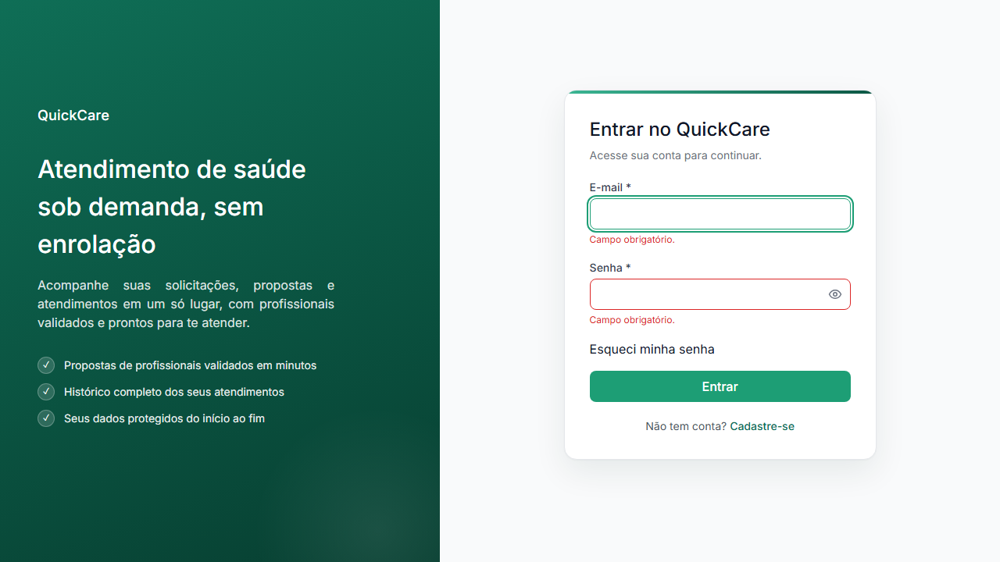
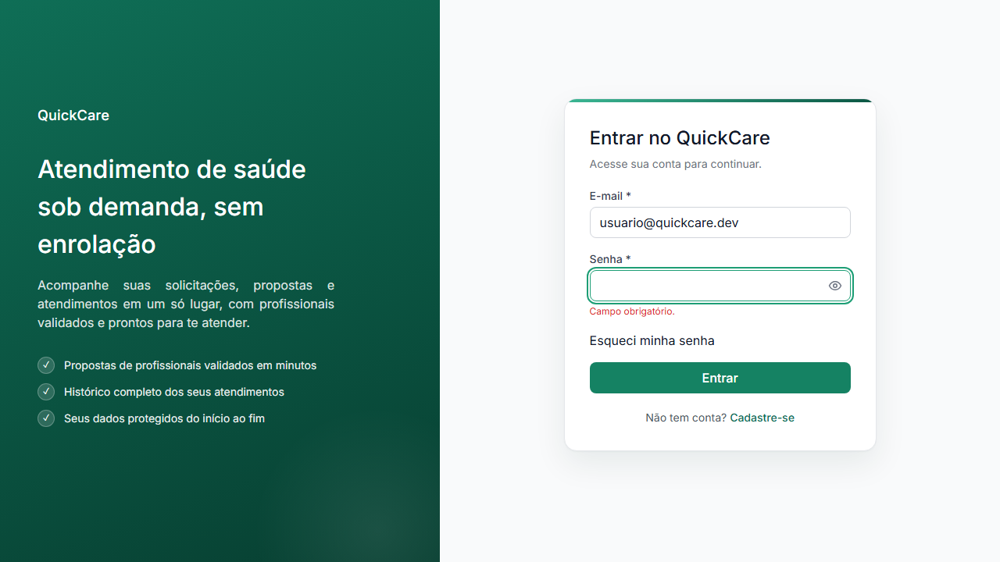
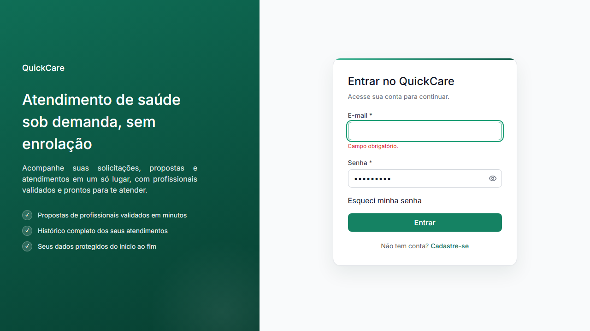
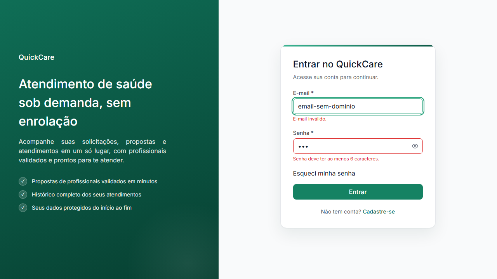
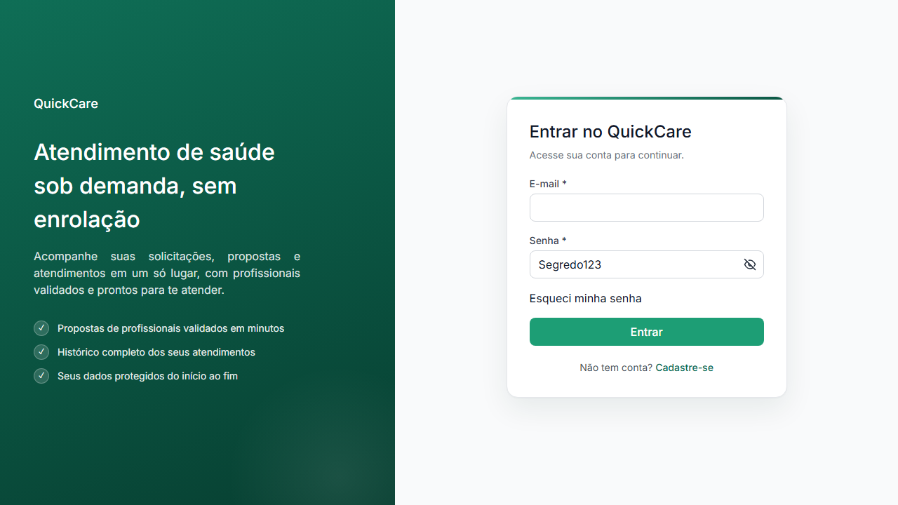
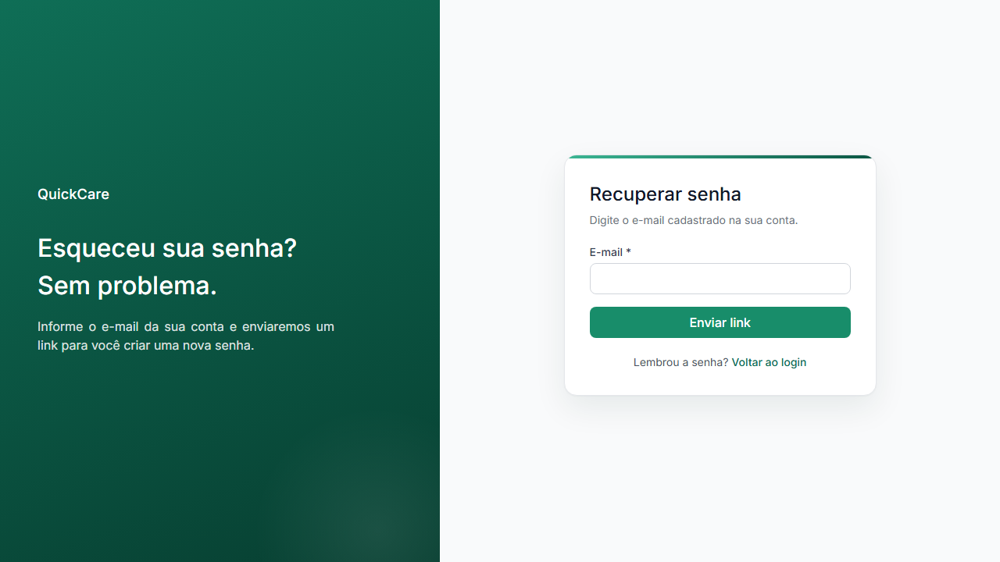
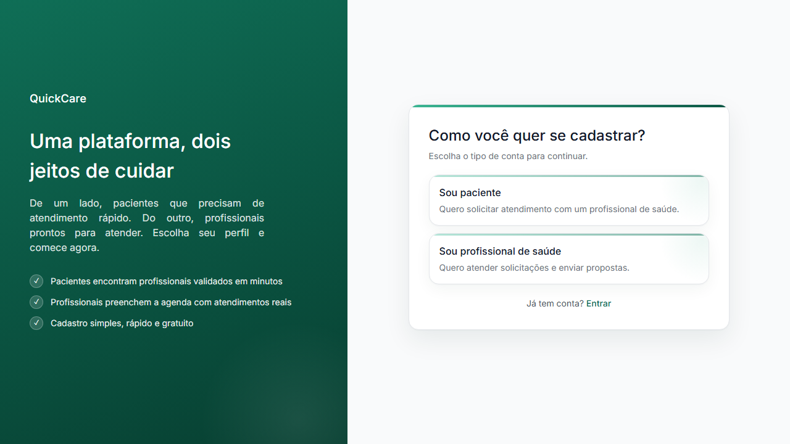
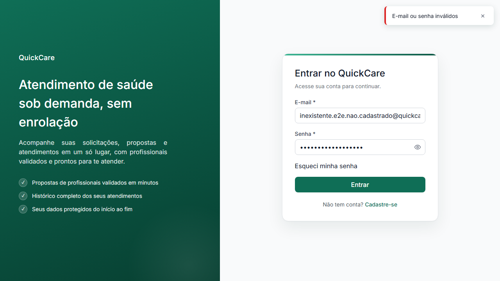

# Relatório de Execução de Testes End-to-End (E2E) — Teste 02

## 1. Identificação e Metadados da Execução

| Campo | Detalhamento |
| :--- | :--- |
| **Suíte de Teste** | `02 - Tela de Login e Validações de Formulário (@smoke)` |
| **Arquivo de Especificação** | `e2e/tests/02-login-validacoes.spec.ts` |
| **Page Object Associado** | `e2e/src/pages/login.page.ts` |
| **Data da Execução** | `15/11/2026` |
| **Horário de Início (BRT / UTC-3)** | `20:31:46` (`2026-11-15T23:31:46.262Z`) |
| **Horário de Término (BRT / UTC-3)** | `20:31:56` (`2026-11-15T23:31:56.755Z`) |
| **Duração Total da Bateria** | `10,49 s` (`10.493 ms`) |
| **Ambiente Alvo (Frontend)** | Produção / Remoto — `https://quickcare-frontend.vercel.app` |
| **Ambiente Alvo (API Backend)** | Produção / Remoto — `https://quickcare-backend-b4a4.onrender.com` |
| **Ferramenta / Motor** | Playwright (`@playwright/test`) + TypeScript — Projeto `chromium-remote` (Chrome Headless `159.0.8154.6`) |
| **Resolução / Localidade** | `1280x720` (Desktop Chrome) · `pt-BR` · `America/Sao_Paulo` |
| **Branch Git** | `test/e2e-playwright` |
| **Responsável / Autoria** | Yasmin Feliciano Pereira Serafim de Lima |

---

## 2. Resumo Executivo dos Resultados

| Métrica | Quantidade / Valor |
| :--- | :---: |
| **Total de Casos de Teste Executados** | `6` |
| **Total de Subetapas Auditadas (`test.step`)** | `8` |
| **Aprovados (`PASSED`)** | `6` |
| **Reprovados (`FAILED`)** | `0` |
| **Ignorados / Instáveis (`SKIPPED` / `FLAKY`)** | `0` |
| **Capturas de Evidência Geradas (`.png`)** | `8` |
| **Taxa de Aprovação** | **100%** |

---

## 3. Quadro Analítico dos Casos de Teste

| ID | Caso de Teste | Pré-Condição | Passos Executados | Resultado Esperado | Resultado Obtido | Tempo | Status |
| :--- | :--- | :--- | :--- | :--- | :--- | :---: | :---: |
| **CT-E2E-02.1** | Submissão do formulário de login completamente vazio | Visitante não autenticado em `/login` | 1. Acessar `/login` e acionar *"Entrar"* sem preencher e-mail nem senha (`2.995 ms`) | Bloquear envio, manter em `/login` e exibir *"Campo obrigatório."* nos dois campos | Mensagens *"Campo obrigatório."* exibidas em vermelho sob E-mail e Senha; rota preservada em `/login` | `3,30 s` (`3.299 ms`) | **APROVADO** |
| **CT-E2E-02.2** | Exigência de senha quando apenas o e-mail é preenchido | Visitante em `/login` | 1. Informar `usuario@quickcare.dev`, manter senha vazia e clicar em *"Entrar"* (`465 ms`) | Aceitar e-mail válido sem erro e exibir *"Campo obrigatório."* exclusivamente na senha | Campo E-mail sem alerta; erro *"Campo obrigatório."* exibido apenas no campo Senha | `0,71 s` (`708 ms`) | **APROVADO** |
| **CT-E2E-02.3** | Exigência de e-mail quando apenas a senha é preenchida | Visitante em `/login` | 1. Informar `Senha@123`, manter e-mail vazio e clicar em *"Entrar"* (`499 ms`) | Aceitar senha sem erro e exibir *"Campo obrigatório."* exclusivamente no e-mail | Campo Senha sem alerta; erro *"Campo obrigatório."* exibido apenas no campo E-mail | `0,73 s` (`726 ms`) | **APROVADO** |
| **CT-E2E-02.4** | Validação de formato inválido de e-mail e tamanho mínimo da senha | Visitante em `/login` | 1. Informar `email-sem-dominio`, senha `123` (< 6 caracteres) e submeter (`449 ms`) | Exibir *"E-mail inválido."* e *"Senha deve ter ao menos 6 caracteres."* | Ambas as mensagens de validação renderizadas simultaneamente sob seus respectivos campos | `0,69 s` (`687 ms`) | **APROVADO** |
| **CT-E2E-02.5** | Alternância de visibilidade da senha e navegação pelos links auxiliares | Visitante em `/login` | 1. Digitar `Segredo123` e alternar ícone *"Mostrar/Ocultar senha"* (`622 ms`) 2. Clicar em *"Esqueci minha senha"* (`225 ms`) 3. Retornar a `/login` e clicar em *"Cadastre-se"* (`384 ms`) | Alternar atributo `type` entre `password` e `text`, e redirecionar para `/esqueci-senha` e `/cadastro` | Texto revelado/ocultado corretamente e telas `/esqueci-senha` e `/cadastro` abertas com sucesso | `1,49 s` (`1.486 ms`) | **APROVADO** |
| **CT-E2E-02.6** | Rejeição de credenciais inexistentes na API com feedback visual | API backend ativa respondendo a `POST /auth/login` | 1. Submeter e-mail não cadastrado com senha incorreta e aguardar retorno HTTP (`1.631 ms`) | Rejeitar login, manter o usuário em `/login` e exibir *toast* de erro claro | *Toast* de erro *"E-mail ou senha inválidos"* exibido no canto superior direito sem expor detalhes internos | `2,13 s` (`2.132 ms`) | **APROVADO** |

---

## 4. Evidências Visuais Capturadas Automaticamente

### 4.1. CT-E2E-02.1 — Submissão com Campos Vazios (`20:31:50 BRT`)

### 4.2. CT-E2E-02.2 — E-mail Preenchido Sem Senha (`20:31:51 BRT`)

### 4.3. CT-E2E-02.3 — Senha Preenchida Sem E-mail (`20:31:52 BRT`)

### 4.4. CT-E2E-02.4 — Formato de E-mail Inválido e Senha Curta (`20:31:52 BRT`)

### 4.5. CT-E2E-02.5 — Visibilidade da Senha e Links Auxiliares (`20:31:53–20:31:54 BRT`)

#### Evidência 05 — Senha Revelada (`type="text"`)

#### Evidência 06 — Navegação para `/esqueci-senha`

#### Evidência 07 — Navegação para `/cadastro`

### 4.6. CT-E2E-02.6 — Rejeição de Credenciais Inexistentes pela API (`20:31:56 BRT`)

---

## 5. Artefatos Complementares Salvos Nesta Pasta

- **Relatório Interativo HTML do Playwright:** `./html-report/index.html` *(para abrir com servidor local: `npm run report:02`)*
- **Log Estruturado JSON de Auditoria:** `./resultado-execucao.json`
- **Diretório de Capturas Originais:** `./prints/`
