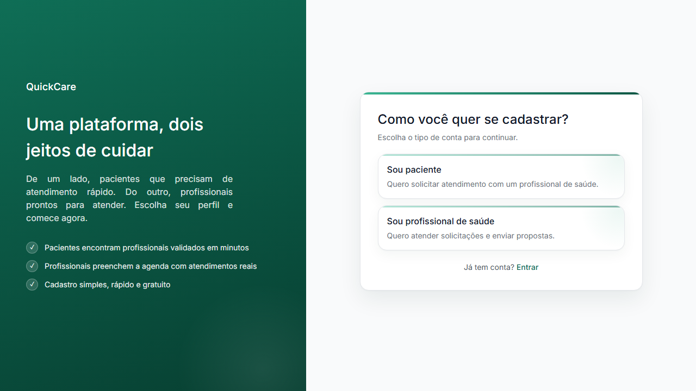
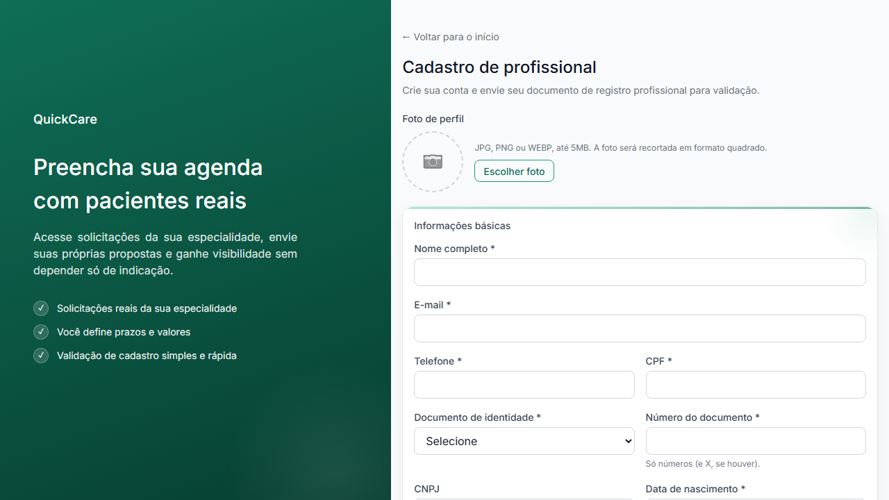
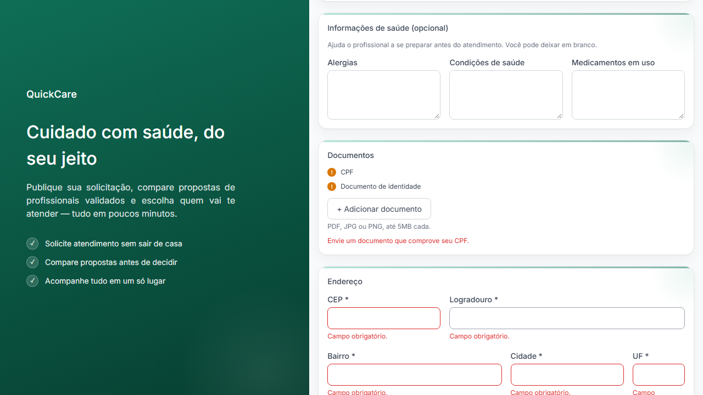
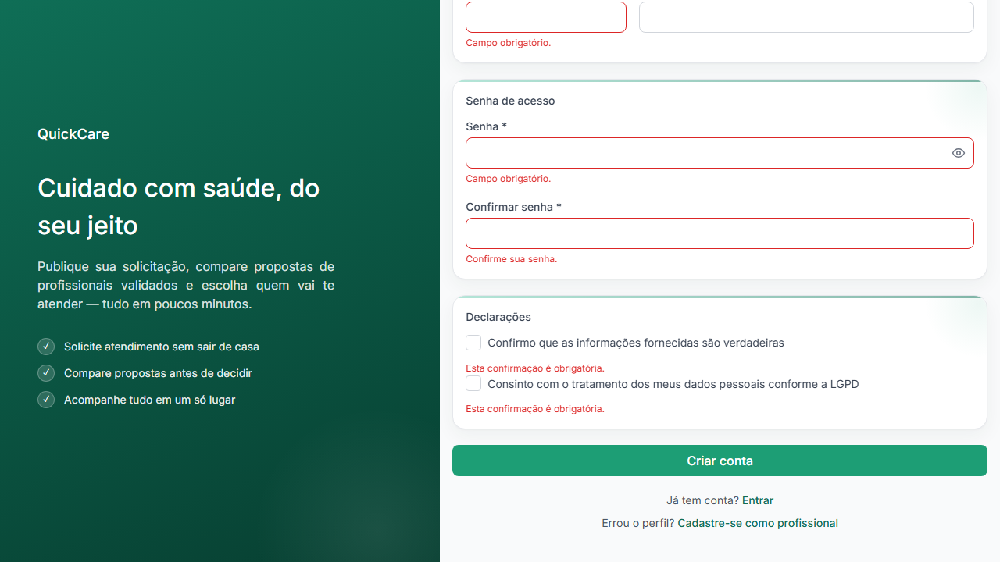
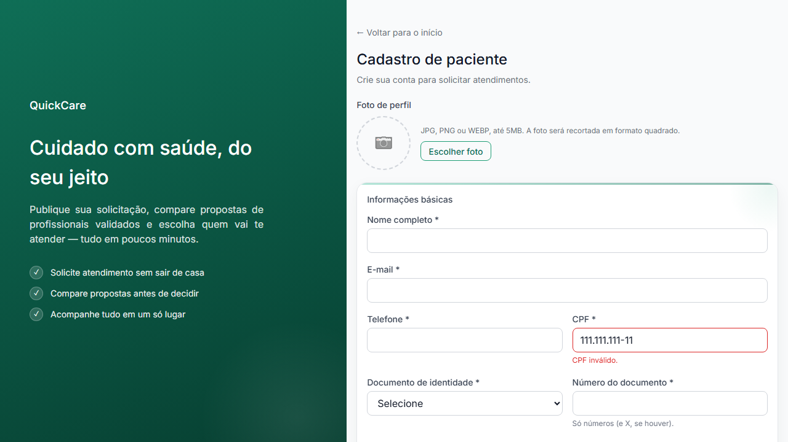
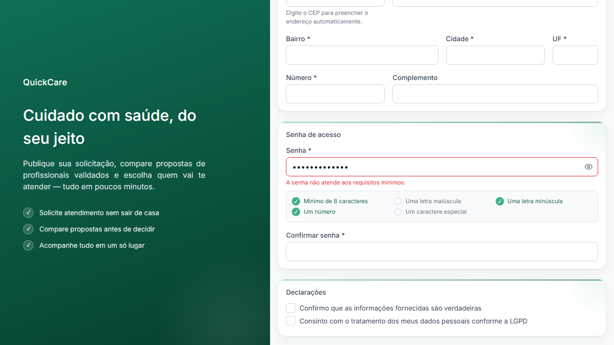
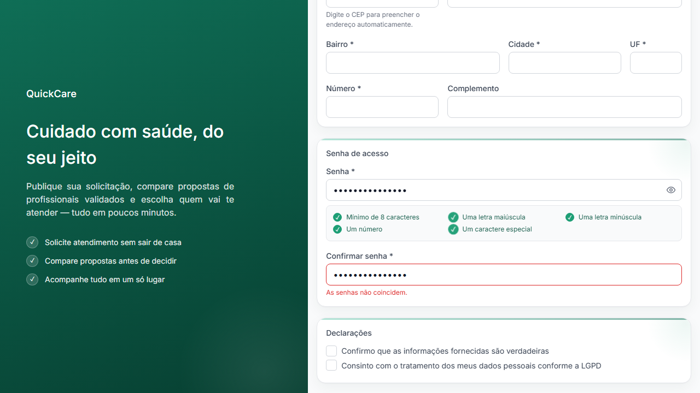

# Relatório de Execução de Testes End-to-End (E2E) — Teste 03

## 1. Identificação e Metadados da Execução

| Campo | Detalhamento |
| :--- | :--- |
| **Suíte de Teste** | `03 - Cadastro, Regras de Validação e Consentimento LGPD (@smoke)` |
| **Arquivo de Especificação** | `e2e/tests/03-cadastro-validacoes-lgpd.spec.ts` |
| **Page Object Associado** | `e2e/src/pages/cadastro.page.ts` |
| **Data da Execução** | `15/11/2026` |
| **Horário de Início (BRT / UTC-3)** | `20:38:47` (`2026-11-15T23:38:47.593Z`) |
| **Horário de Término (BRT / UTC-3)** | `20:38:55` (`2026-11-15T23:38:55.684Z`) |
| **Duração Total da Bateria** | `8,09 s` (`8.091 ms`) |
| **Ambiente Alvo (Frontend)** | Produção / Remoto — `https://quickcare-frontend.vercel.app` |
| **Ambiente Alvo (API Backend)** | Produção / Remoto — `https://quickcare-backend-b4a4.onrender.com` |
| **Ferramenta / Motor** | Playwright (`@playwright/test`) + TypeScript — Projeto `chromium-remote` (Chrome Headless `159.0.8154.6`) |
| **Resolução / Localidade** | `1280x720` (Desktop Chrome) · `pt-BR` · `America/Sao_Paulo` |
| **Branch Git** | `test/e2e-playwright` |
| **Responsável / Autoria** | Yasmin Feliciano Pereira Serafim de Lima |

---

## 2. Resumo Executivo dos Resultados

| Métrica | Quantidade / Valor |
| :--- | :---: |
| **Total de Casos de Teste Executados** | `4` |
| **Total de Subetapas Auditadas (`test.step`)** | `9` |
| **Aprovados (`PASSED`)** | `4` |
| **Reprovados (`FAILED`)** | `0` |
| **Ignorados / Instáveis (`SKIPPED` / `FLAKY`)** | `0` |
| **Capturas de Evidência Geradas (`.png`)** | `7` |
| **Taxa de Aprovação** | **100%** |

---

## 3. Quadro Analítico dos Casos de Teste

| ID | Caso de Teste | Pré-Condição | Passos Executados | Resultado Esperado | Resultado Obtido | Tempo | Status |
| :--- | :--- | :--- | :--- | :--- | :--- | :---: | :---: |
| **CT-E2E-03.1** | Seleção de perfil em `/cadastro` e direcionamento para paciente ou profissional | Visitante acessando `/cadastro` | 1. Acessar `/cadastro` e verificar cards de escolha (`658 ms`) 2. Clicar em *"Sou paciente"* (`266 ms`) 3. Retornar e clicar em *"Sou profissional de saúde"* (`703 ms`) | Exibir as duas jornadas de cadastro e direcionar corretamente para `/cadastro/paciente` e `/cadastro/profissional` | Ambas as opções visíveis e formulários específicos de paciente e profissional carregados com sucesso | `2,05 s` (`2.051 ms`) | **APROVADO** |
| **CT-E2E-03.2** | Bloqueio de submissão vazia exigindo documentos comprobatórios e aceite LGPD | Visitante em `/cadastro/paciente` sem gravar dados no banco | 1. Acionar *"Criar conta"* com campos vazios e validar seção de documentos (`956 ms`) 2. Validar seção de declarações e LGPD (`256 ms`) | Bloquear envio exigindo comprovante de CPF, declaração de veracidade e consentimento LGPD | Exibidas as mensagens *"Envie um documento que comprove seu CPF."* e 2 alertas *"Esta confirmação é obrigatória."* | `1,58 s` (`1.580 ms`) | **APROVADO** |
| **CT-E2E-03.3** | Aplicação de máscara automática de CPF e rejeição por dígitos verificadores | Visitante em `/cadastro/paciente` | 1. Digitar `11111111111` no campo CPF e retirar o foco (`753 ms`) | Formatar automaticamente para `111.111.111-11` e acusar CPF matematicamente inválido | Valor formatado com máscara de pontuação e erro *"CPF inválido."* exibido sob o campo | `1,12 s` (`1.124 ms`) | **APROVADO** |
| **CT-E2E-03.4** | Requisitos de senha forte, confirmação divergente e limite máximo na data de nascimento | Visitante em `/cadastro/paciente` | 1. Verificar atributo `max` (`YYYY-MM-DD`) em Data de nascimento (`692 ms`) 2. Informar senha fraca `senhafraca123` (`397 ms`) 3. Informar `SenhaForte@2026` e confirmação `OutraSenha@2026` (`320 ms`) | Restringir datas futuras, exibir checklist dinâmico de complexidade na senha fraca e alertar divergência na confirmação | Atributo `max` ativo, checklist de 5 critérios validado e mensagem *"As senhas não coincidem."* exibida | `1,70 s` (`1.698 ms`) | **APROVADO** |

---

## 4. Evidências Visuais Capturadas Automaticamente

### 4.1. CT-E2E-03.1 — Escolha de Perfil e Formulário de Profissional (`20:38:49–20:38:50 BRT`)

#### Evidência 01 — Escolha do Tipo de Conta em `/cadastro`

#### Evidência 02 — Formulário `/cadastro/profissional` Carregado

---

### 4.2. CT-E2E-03.2 — Exigência Documental e Consentimento LGPD (`20:38:52 BRT`)

#### Evidência 03 — Bloqueio por Falta de Documento Comprobatório de CPF

#### Evidência 04 — Obrigatoriedade das Declarações de Veracidade e Tratamento de Dados (LGPD)

---

### 4.3. CT-E2E-03.3 — Máscara e Dígito Verificador de CPF (`20:38:53 BRT`)

#### Evidência 05 — CPF `111.111.111-11` Rejeitado pelo Algoritmo Validador

---

### 4.4. CT-E2E-03.4 — Complexidade da Senha e Divergência de Confirmação (`20:38:54–20:38:55 BRT`)

#### Evidência 06 — Checklist Dinâmico e Alerta em Senha Fraca

#### Evidência 07 — Senha Forte Válida (5/5 Critérios) com Confirmação Divergente

---

## 5. Artefatos Complementares Salvos Nesta Pasta

- **Relatório Interativo HTML do Playwright:** `./html-report/index.html` *(para abrir com servidor local: `npm run report:03`)*
- **Log Estruturado JSON de Auditoria:** `./resultado-execucao.json`
- **Diretório de Capturas Originais:** `./prints/`
