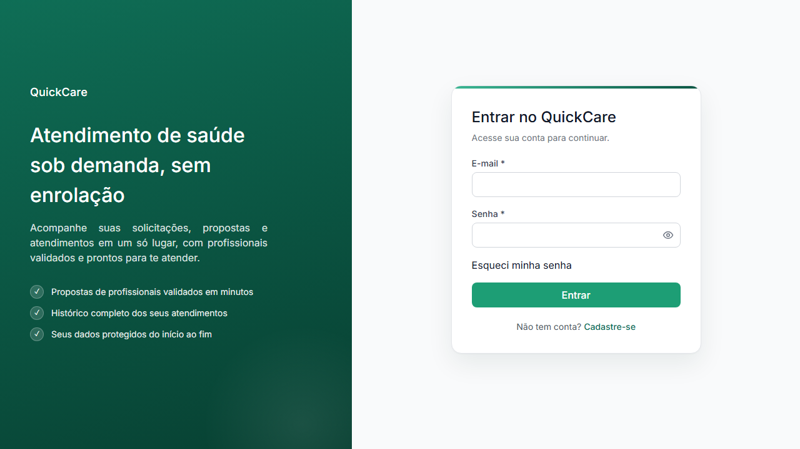
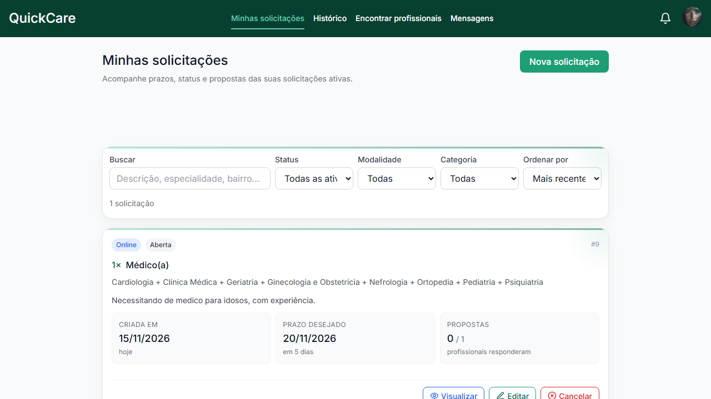
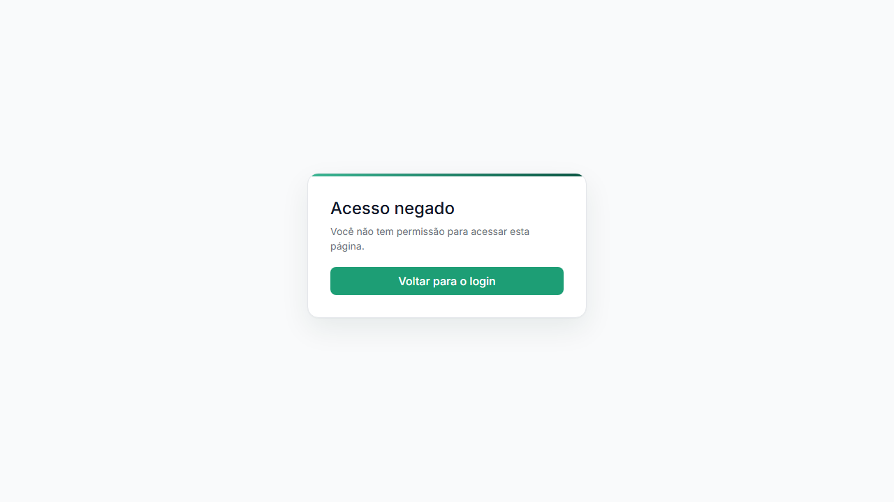
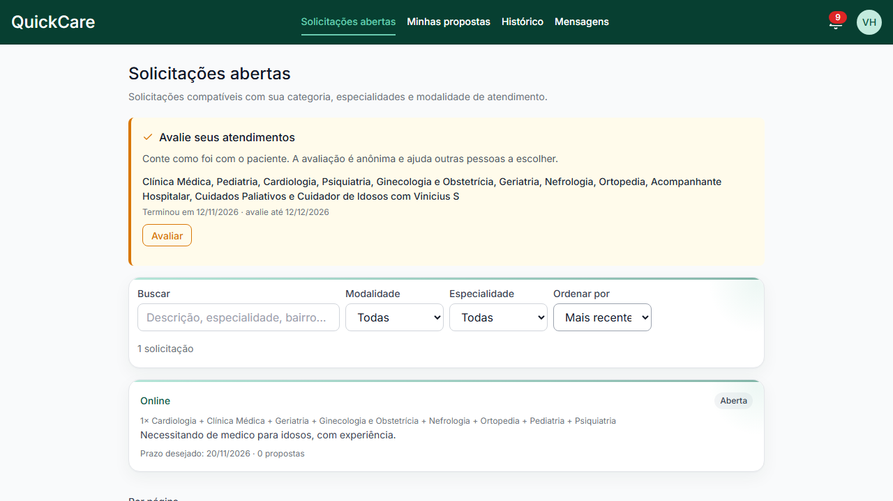
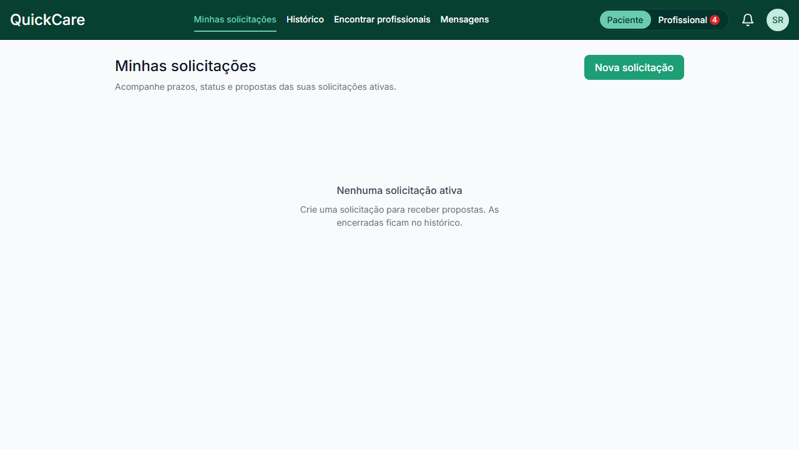
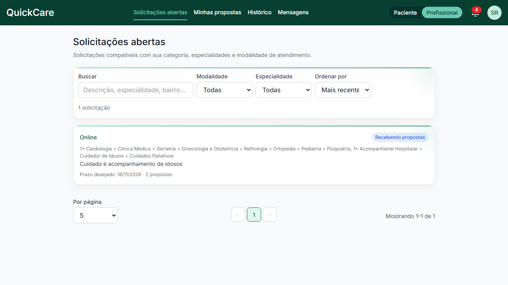
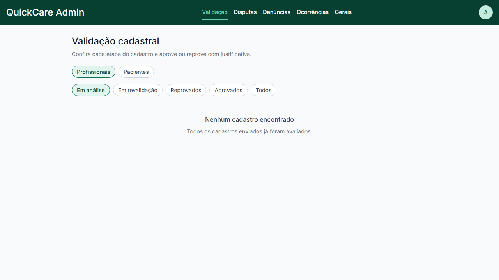

# Relatório de Execução de Testes End-to-End (E2E) — Teste 04

## 1. Identificação e Metadados da Execução

| Campo | Detalhamento |
| :--- | :--- |
| **Suíte de Teste** | `04 - Proteção de Rotas (Guards), Autenticação por Perfil e Multiconta (@smoke / @auth)` |
| **Arquivo de Especificação** | `e2e/tests/04-autenticacao-guards-perfis.spec.ts` |
| **Page Objects Associados** | `paciente.page.ts` · `profissional.page.ts` · `admin.page.ts` · `login.page.ts` |
| **Data da Execução** | `15/11/2026` |
| **Horário de Início (BRT / UTC-3)** | `21:45:10` (`2026-11-16T00:45:10.506Z`) |
| **Horário de Término (BRT / UTC-3)** | `21:45:48` (`2026-11-16T00:45:48.171Z`) |
| **Duração Total da Bateria** | `37,67 s` (`37.665 ms`) |
| **Ambiente Alvo (Frontend)** | Produção / Remoto — `https://quickcare-frontend.vercel.app` |
| **Ambiente Alvo (API Backend)** | Produção / Remoto — `https://quickcare-backend-b4a4.onrender.com` |
| **Gestão de Segredos** | Variáveis isoladas em `e2e/.env.remote` (ignorado pelo Git via `.gitignore`) |
| **Ferramenta / Motor** | Playwright (`@playwright/test`) + TypeScript — Projeto `chromium-remote` (Chrome Headless `159.0.8154.6`) |
| **Resolução / Localidade** | `1280x720` (Desktop Chrome) · `pt-BR` · `America/Sao_Paulo` |
| **Branch Git** | `test/e2e-playwright` |
| **Responsável / Autoria** | Yasmin Feliciano Pereira Serafim de Lima |

---

## 2. Resumo Executivo dos Resultados

| Métrica | Quantidade / Valor |
| :--- | :---: |
| **Total de Casos de Teste Executados** | `5` |
| **Total de Subetapas Auditadas (`test.step`)** | `8` |
| **Aprovados (`PASSED`)** | `5` |
| **Reprovados (`FAILED`)** | `0` |
| **Ignorados / Instáveis (`SKIPPED` / `FLAKY`)** | `0` |
| **Capturas de Evidência Geradas (`.png`)** | `8` |
| **Taxa de Aprovação** | **100%** |

---

## 3. Quadro Analítico dos Casos de Teste

| ID | Caso de Teste | Pré-Condição | Passos Executados | Resultado Esperado | Resultado Obtido | Tempo | Status |
| :--- | :--- | :--- | :--- | :--- | :--- | :---: | :---: |
| **CT-E2E-04.1** | Bloqueio de visitante não autenticado em rotas protegidas (`authGuard`) | Sessão anônima (sem token JWT) | 1. Tentar navegar diretamente para `/patient`, `/professional` e `/admin/validacao` (`3.311 ms`) | Interceptar acesso em todas as rotas restritas e redirecionar para `/login` | Todas as 3 áreas restritas bloquearam o acesso anônimo e redirecionaram para `/login` | `3,77 s` (`3.768 ms`) | **APROVADO** |
| **CT-E2E-04.2** | Autenticação de Paciente, bloqueio RBAC em `/admin` e Logout | Conta de Paciente ativa em `.env.remote` | 1. Autenticar como Paciente e carregar `/patient` (`4.872 ms`) 2. Tentar acessar `/admin/validacao` (`2.080 ms`) 3. Retornar e acionar *"Sair"* no menu da conta (`2.577 ms`) | Carregar painel *"Minhas solicitações"*, bloquear acesso administrativo em `/acesso-negado` (`roleGuard`) e encerrar sessão | Painel carregado, tentativa em `/admin/validacao` bloqueada em `/acesso-negado` e sessão encerrada com sucesso | `10,23 s` (`10.226 ms`) | **APROVADO** |
| **CT-E2E-04.3** | Autenticação de Profissional de saúde e acesso ao painel restrito | Conta de Profissional ativa em `.env.remote` | 1. Autenticar como Profissional e aguardar carregamento de `/professional` (`6.052 ms`) | Autenticar via JWT e carregar o painel restrito do profissional com demandas compatíveis | Rota `/professional` carregada com cabeçalho e listagem de solicitações compatíveis | `6,28 s` (`6.278 ms`) | **APROVADO** |
| **CT-E2E-04.4** | Alternância dinâmica de perfil em conta Multiconta (`Paciente <-> Profissional`) | Conta com duplo vínculo cadastral em `.env.remote` | 1. Autenticar conta multiconta e validar componente `Perfil em uso` no topo (`3.641 ms`) 2. Alternar de Paciente para Profissional e retornar (`6.771 ms`) | Exibir seletor no cabeçalho e trocar contexto/rotas (`/patient` <-> `/professional`) sem novo login | Seletor exibido com contador de notificações por perfil e troca imediata entre `/patient` e `/professional` | `10,69 s` (`10.687 ms`) | **APROVADO** |
| **CT-E2E-04.5** | Autenticação de Administrador e fila de Validação cadastral | Conta de Administrador ativa em `.env.remote` | 1. Autenticar como Administrador e carregar `/admin/validacao` (`4.355 ms`) | Redirecionar para `/admin/validacao` e exibir painel *QuickCare Admin* com filtros por perfil e situação | Painel *Validação cadastral* carregado com navegação administrativa completa | `4,57 s` (`4.574 ms`) | **APROVADO** |

---

## 4. Evidências Visuais Capturadas Automaticamente

### 4.1. CT-E2E-04.1 — Proteção de Rotas para Visitante (`21:45:15 BRT`)

---

### 4.2. CT-E2E-04.2 — Painel do Paciente, Bloqueio RBAC (`/acesso-negado`) e Logout (`21:45:20–21:45:25 BRT`)

#### Evidência 02 — Painel do Paciente Autenticado (`/patient`)

#### Evidência 03 — Bloqueio de Controle de Acesso Baseado em Papel (`roleGuard` -> `/acesso-negado`)

#### Evidência 04 — Encerramento Seguro de Sessão (`Sair`)

---

### 4.3. CT-E2E-04.3 — Ambiente Restrito do Profissional de Saúde (`21:45:32 BRT`)

---

### 4.4. CT-E2E-04.4 — Conta Multiconta e Alternância Dinâmica de Perfil (`21:45:36–21:45:41 BRT`)

#### Evidência 06 — Conta Multiconta Ativa no Perfil Inicial (Paciente)

#### Evidência 07 — Contexto Alternado Dinamicamente para Profissional

---

### 4.5. CT-E2E-04.5 — Painel Administrativo de Validação Cadastral (`21:45:47 BRT`)

---

## 5. Artefatos Complementares Salvos Nesta Pasta

- **Relatório Interativo HTML do Playwright:** `./html-report/index.html` *(para abrir com servidor local: `npm run report:04`)*
- **Log Estruturado JSON de Auditoria:** `./resultado-execucao.json`
- **Diretório de Capturas Originais:** `./prints/`
