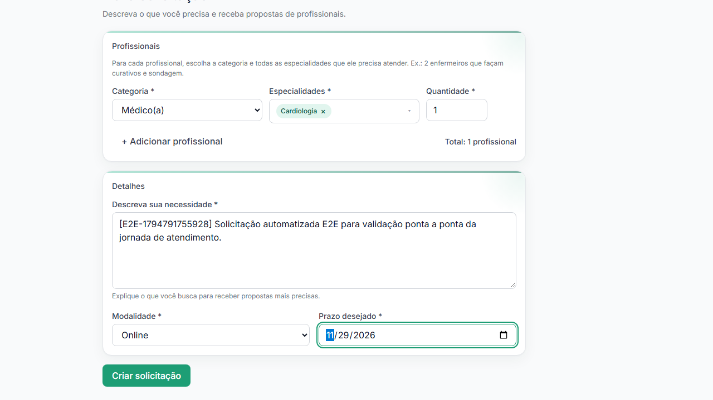
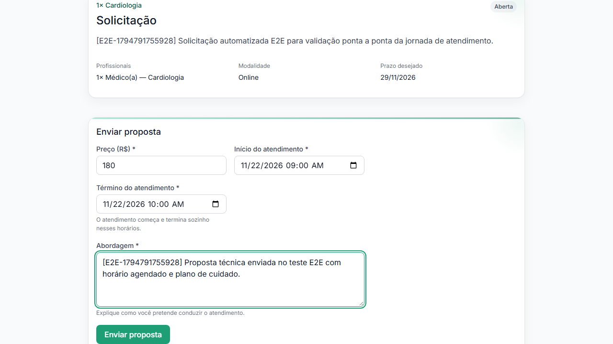
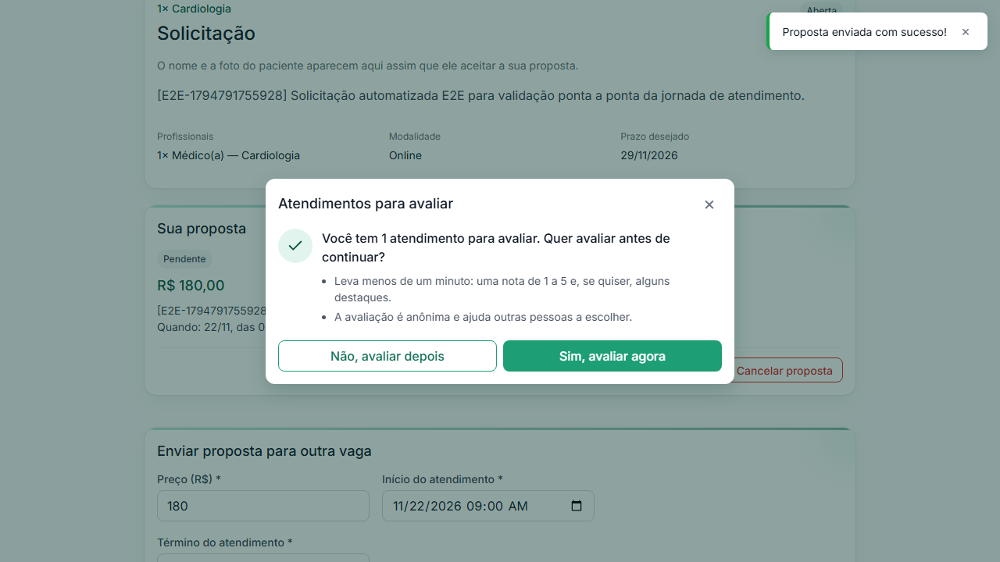
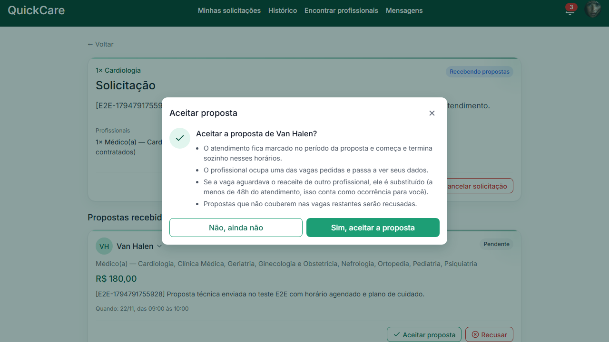
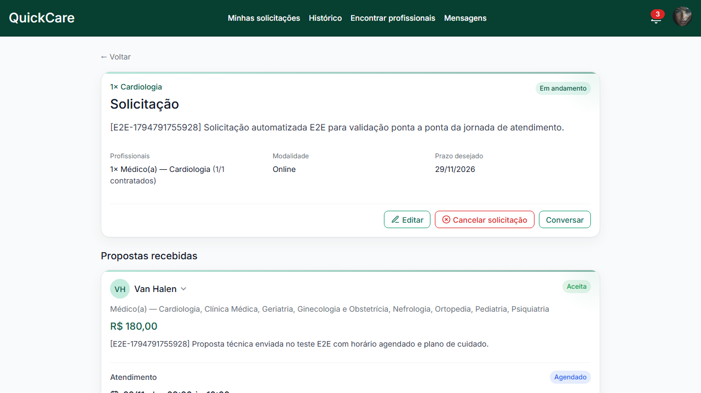
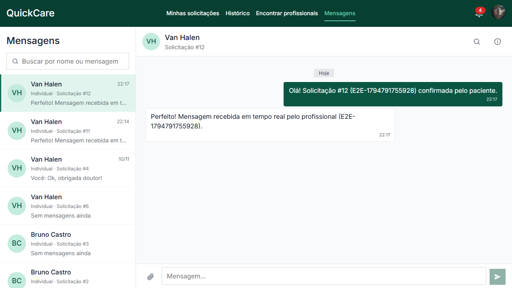
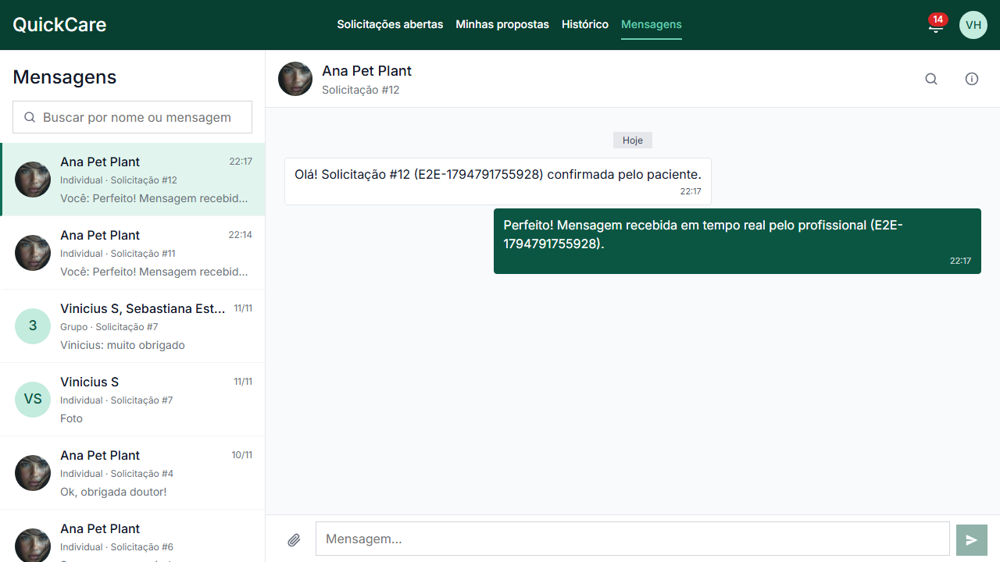
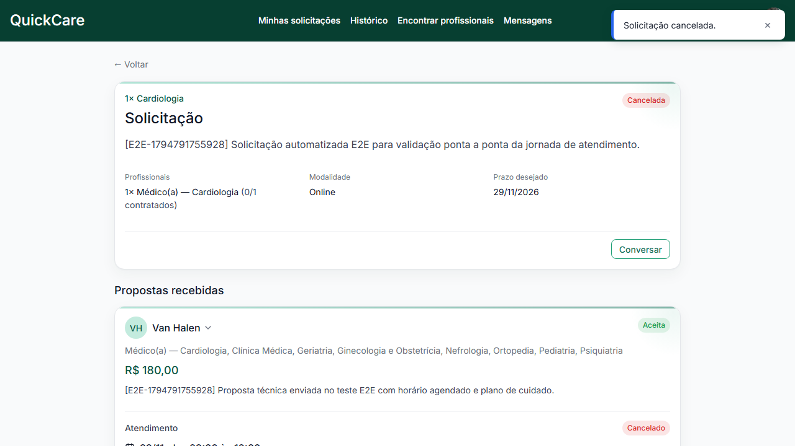

# Relatório de Execução de Testes End-to-End (E2E) — Teste 05

## 1. Identificação e Metadados da Execução

| Campo | Detalhamento |
| :--- | :--- |
| **Suíte de Teste** | `05 - Jornada Completa Multiusuário (Solicitação -> Proposta -> Aceite -> Chat WebSocket) (@fluxo)` |
| **Arquivo de Especificação** | `e2e/tests/05-jornada-completa-multiusuario.spec.ts` |
| **Page Objects Associados** | `paciente.page.ts` · `profissional.page.ts` · `chat.page.ts` · `login.page.ts` |
| **Data da Execução** | `15/11/2026` |
| **Horário de Início (BRT / UTC-3)** | `22:15:52` (`2026-11-16T01:15:52.860Z`) |
| **Horário de Término (BRT / UTC-3)** | `22:17:38` (`2026-11-16T01:17:38.575Z`) |
| **Duração Total da Bateria** | `105,72 s` (`1 min 45,7 s` · `105.715 ms`) |
| **Ambiente Alvo (Frontend)** | Produção / Remoto — `https://quickcare-frontend.vercel.app` |
| **Ambiente Alvo (API & WebSocket)** | Produção / Remoto — `https://quickcare-backend-b4a4.onrender.com` (REST + STOMP/WebSocket) |
| **Arquitetura do Teste** | **2 Contextos Isolados Simultâneos (`browser.newContext()`)** — Sessão 1: Paciente · Sessão 2: Profissional |
| **Resolução / Localidade** | `1280x720` (Desktop Chrome `159.0.8154.6`) · `pt-BR` · `America/Sao_Paulo` |
| **Branch Git** | `test/e2e-playwright` |
| **Responsável / Autoria** | Yasmin Feliciano Pereira Serafim de Lima |

---

## 2. Resumo Executivo dos Resultados

| Métrica | Quantidade / Valor |
| :--- | :---: |
| **Jornada Ponta a Ponta Executada (`CT-E2E-05.1`)** | `1` (Multiusuário Completo) |
| **Etapas Funcionais Encadeadas (`test.step`)** | `6` |
| **Aprovados (`PASSED`)** | `1` (`6/6` etapas concluídas sem erros) |
| **Reprovados (`FAILED`)** | `0` |
| **Ignorados / Instáveis (`SKIPPED` / `FLAKY`)** | `0` |
| **Capturas de Evidência Geradas (`.png`)** | `9` |
| **Higiene de Dados pós-execução** | **Solicitação #12 cancelada automaticamente ao final (`Cancelada`)** |
| **Taxa de Aprovação** | **100%** |

---

## 3. Quadro Analítico das Etapas da Jornada Multiusuário (`CT-E2E-05.1`)

| Etapa | Ator / Sessão | Ação Executada | Resultado Esperado | Resultado Obtido | Tempo | Status |
| :---: | :--- | :--- | :--- | :--- | :---: | :---: |
| **5.1** | Profissional (`Contexto 2`) | Autentica e consulta `/perfil/profissional` + `/atuacoes` para identificar área liberada | Obter categoria, especialidade e modalidade aptas a envio de propostas | Identificada atuação aprovada `MEDICO` -> `Cardiologia` na modalidade `Online` | `7,48 s` (`7.480 ms`) | **APROVADO** |
| **5.2** | Paciente (`Contexto 1`) | Autentica em sessão isolada, preenche `/patient/novo` e publica solicitação compatível | Persistir nova solicitação via `POST /solicitacoes` e exibir status inicial | **Solicitação #12** criada com sucesso (`1x Médico(a) — Cardiologia`, `Online`) aguardando propostas | `10,95 s` (`10.947 ms`) | **APROVADO** |
| **5.3** | Profissional (`Contexto 2`) | Abre `/professional/solicitacoes/12` e envia proposta (`R$ 180,00`, horário futuro +7 dias) | Registrar proposta via `POST /propostas` com status `Pendente` | Proposta registrada com sucesso e exibida no card *"Sua proposta"* | `14,84 s` (`14.843 ms`) | **APROVADO** |
| **5.4** | Paciente (`Contexto 1`) | Visualiza proposta recebida em `/patient/solicitacoes/12`, abre modal e confirma aceite | Transitar proposta para `Aceita`, criar atendimento agendado e habilitar botão *"Conversar"* | Modal de regras exibido, proposta aceita e botão *"Conversar"* liberado | `16,00 s` (`15.999 ms`) | **APROVADO** |
| **5.5** | Paciente + Profissional (Simultâneo) | Ambos abrem o canal privado da Solicitação #12 e trocam mensagens em tempo real | Entrega instantânea bidirecional via broker **STOMP/WebSocket** sem recarregar a página | Paciente enviou confirmação às `22:17`, Profissional recebeu ao vivo e respondeu às `22:17` com recepção imediata pelo Paciente | `40,77 s` (`40.766 ms`) | **APROVADO** |
| **5.6** | Paciente (`Contexto 1`) | Autolimpeza: retorna a `/patient/solicitacoes/12` e cancela a solicitação de teste (> 48h, sem ocorrência) | Encerrar solicitação e atendimento agendado preservando a base de produção limpa | Solicitação #12 e atendimento marcados como **`Cancelada` / `Cancelado`** com *toast* de confirmação | `10,46 s` (`10.457 ms`) | **APROVADO** |

---

## 4. Evidências Visuais Capturadas Automaticamente

### 4.1. Criação da Solicitação pelo Paciente (`Contexto 1`)

#### Evidência 01 — Formulário `/patient/novo` Preenchido com Especialidade Compatível (`22:16:11 BRT`)

#### Evidência 02 — Solicitação #12 Criada Aguardando Propostas (`22:16:13 BRT`)

---

### 4.2. Envio da Proposta pelo Profissional (`Contexto 2`)

#### Evidência 03 — Profissional Visualiza Solicitação #12 e Preenche Proposta (`22:16:22 BRT`)

#### Evidência 04 — Proposta Registrada com Status `Pendente` (`22:16:28 BRT`)

---

### 4.3. Aceite Formal da Proposta pelo Paciente (`Contexto 1`)

#### Evidência 05 — Modal de Confirmação com Regras de Negócio do Aceite (`22:16:36 BRT`)

#### Evidência 06 — Proposta Aceita, Atendimento Agendado e Botão *"Conversar"* Liberado (`22:16:44 BRT`)

---

### 4.4. Comunicação Bidirecional em Tempo Real via Chat WebSocket (`Contexto 1` + `Contexto 2`)

#### Evidência 07 — Visão do Paciente no Chat (Mensagem Enviada + Resposta Recebida ao Vivo às `22:17`)

#### Evidência 08 — Visão Simultânea do Profissional no Chat (Recebimento + Resposta ao Vivo às `22:17`)

---

### 4.5. Autolimpeza Responsável Pós-Teste (`Contexto 1`)

#### Evidência 09 — Solicitação #12 e Atendimento Cancelados Automaticamente ao Final (`22:17:35 BRT`)

---

## 5. Artefatos Complementares Salvos Nesta Pasta

- **Relatório Interativo HTML do Playwright:** `./html-report/index.html` *(para abrir com servidor local: `npm run report:05`)*
- **Log Estruturado JSON de Auditoria:** `./resultado-execucao.json`
- **Diretório de Capturas Originais:** `./prints/`
