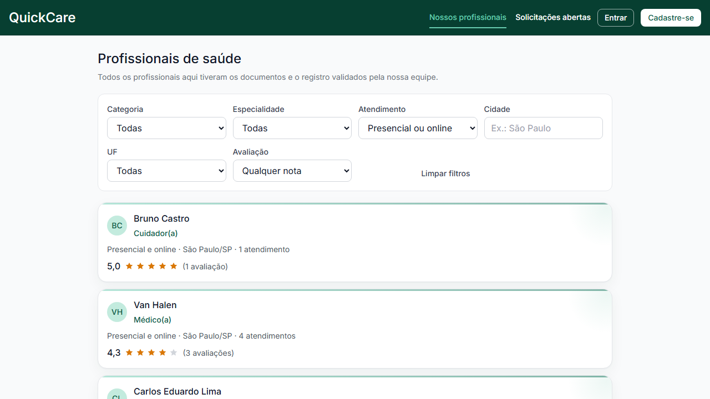
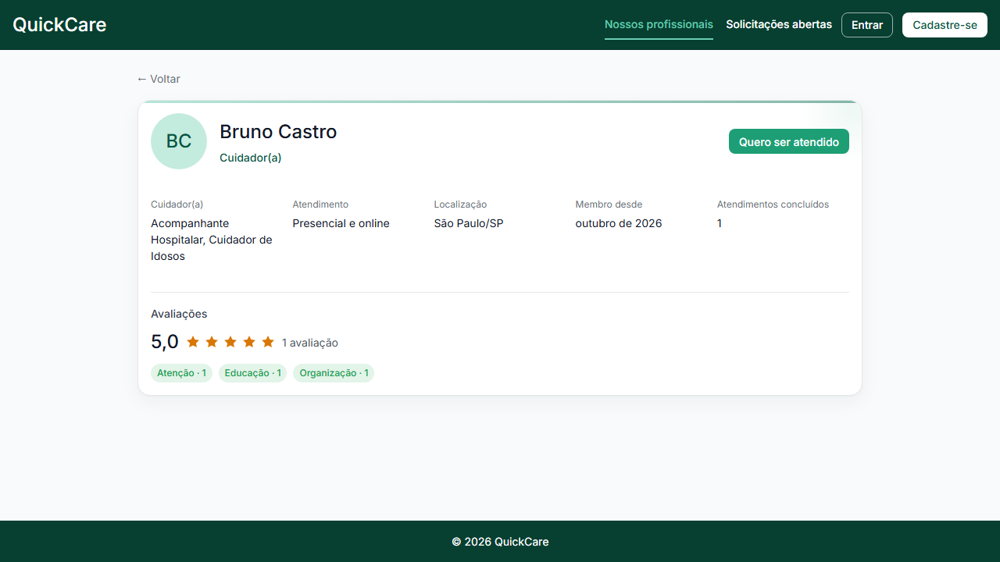
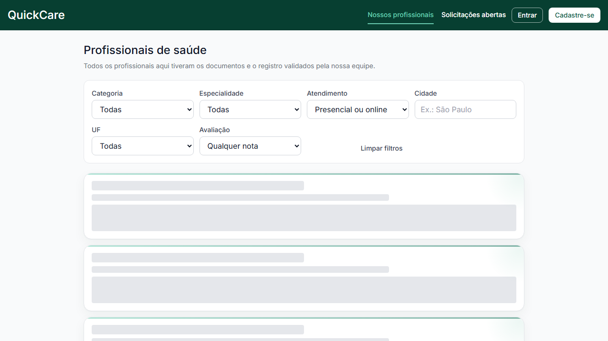
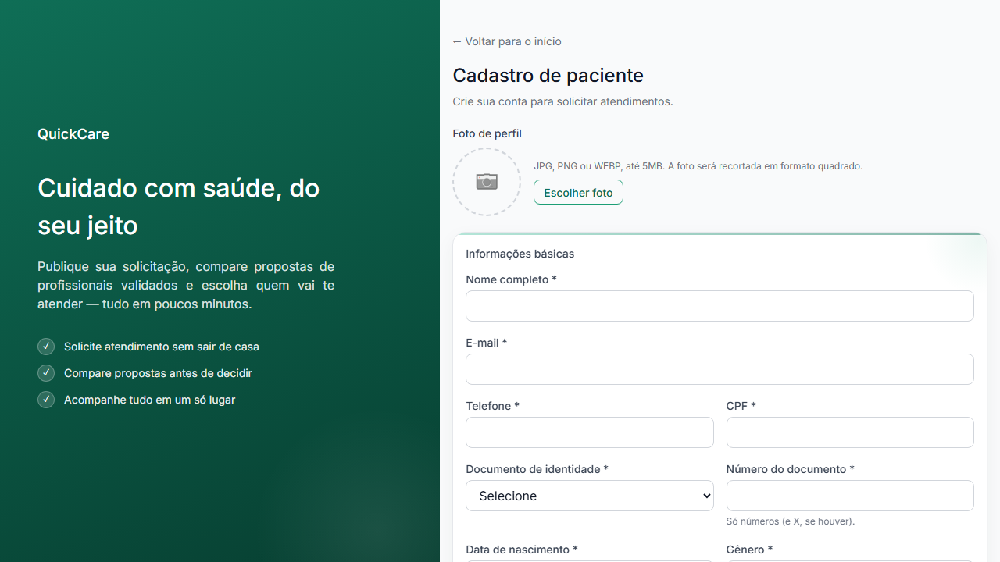
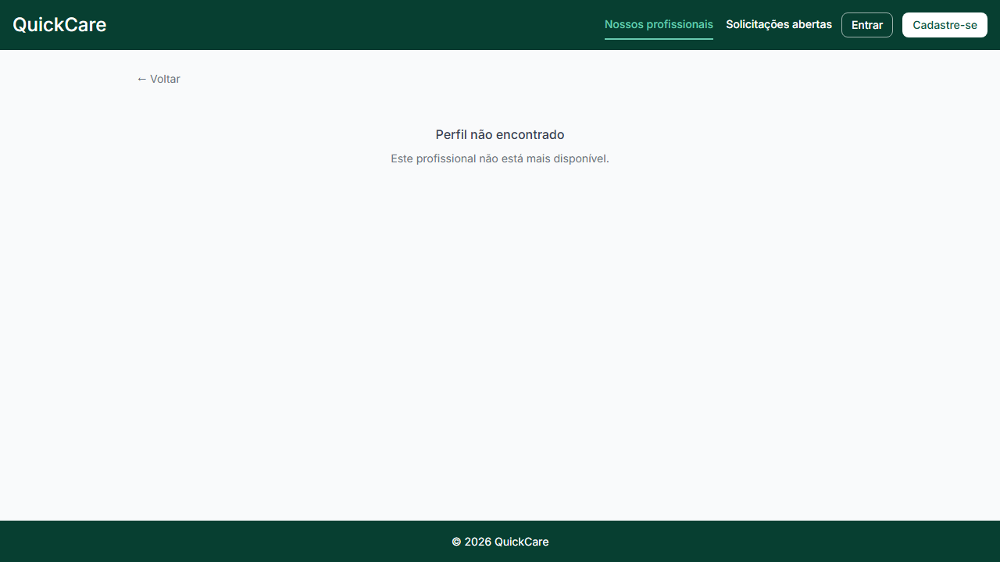

# Relatório de Execução de Testes End-to-End (E2E) — Teste 06

## 1. Identificação e Metadados da Execução

| Campo | Detalhamento |
| :--- | :--- |
| **Suíte de Teste** | `06 - Perfil Público Detalhado do Profissional (@smoke)` |
| **Arquivo de Especificação** | `e2e/tests/06-perfil-publico-profissional.spec.ts` |
| **Page Object Associado** | `e2e/src/pages/consulta-publica.page.ts` |
| **Data da Execução** | `15/11/2026` |
| **Horário de Início (BRT / UTC-3)** | `23:34:31` (`2026-11-16T02:34:31.218Z`) |
| **Horário de Término (BRT / UTC-3)** | `23:35:13` (`2026-11-16T02:35:13.185Z`) |
| **Duração Total da Bateria** | `41,97 s` (`41.967 ms`) |
| **Ambiente Alvo (Frontend)** | Produção / Remoto — `https://quickcare-frontend.vercel.app` |
| **Ambiente Alvo (API Backend)** | Produção / Remoto — `https://quickcare-backend-b4a4.onrender.com` |
| **Ferramenta / Motor** | Playwright (`@playwright/test`) + TypeScript — Projeto `chromium-remote` (Chrome Headless `159.0.8154.6`) |
| **Resolução / Localidade** | `1280x720` (Desktop Chrome) · `pt-BR` · `America/Sao_Paulo` |
| **Branch Git** | `test/e2e-playwright` |
| **Responsável / Autoria** | Yasmin Feliciano Pereira Serafim de Lima |

---

## 2. Resumo Executivo dos Resultados

| Métrica | Quantidade / Valor |
| :--- | :---: |
| **Total de Casos de Teste Executados** | `3` |
| **Total de Subetapas Auditadas (`test.step`)** | `5` |
| **Aprovados (`PASSED`)** | `3` |
| **Reprovados (`FAILED`)** | `0` |
| **Ignorados / Instáveis (`SKIPPED` / `FLAKY`)** | `0` |
| **Capturas de Evidência Geradas (`.png`)** | `5` |
| **Taxa de Aprovação** | **100%** |

---

## 3. Quadro Analítico dos Casos de Teste

| ID | Caso de Teste | Pré-Condição | Passos Executados | Resultado Esperado | Resultado Obtido | Tempo | Status |
| :--- | :--- | :--- | :--- | :--- | :--- | :---: | :---: |
| **CT-E2E-06.1** | Abertura do perfil público detalhado de um profissional validado | Vitrine pública `/consulta/profissionais` ativa | 1. Selecionar o primeiro card da vitrine (`12.806 ms`) 2. Validar identidade, atuações, localização e avaliações em `/consulta/profissionais/:id` (`2.051 ms`) | Carregar ficha pública completa do profissional selecionado com nota média e tags de elogios | Perfil de *Bruno Castro* renderizado com especialidades, modalidade, localização, *5,0 ★* e tags de avaliação | `15,84 s` (`15.835 ms`) | **APROVADO** |
| **CT-E2E-06.2** | Retorno pelo link *Voltar* e conversão pelo CTA *"Quero ser atendido"* | Visitante anônimo em `/consulta/profissionais/:id` | 1. Acionar `← Voltar` e validar retorno à listagem (`11.384 ms`) 2. Reabrir perfil e acionar CTA *"Quero ser atendido"* (`11.327 ms`) | Retornar corretamente à vitrine pública e direcionar o visitante para `/cadastro/paciente` | Ambos os fluxos de navegação e conversão funcionaram sem recarregamento indevido | `23,07 s` (`23.069 ms`) | **APROVADO** |
| **CT-E2E-06.3** | Tratamento resiliente de identificador inexistente de profissional | Acesso direto a `/consulta/profissionais/999999999` | 1. Consultar ID inexistente e verificar componente de estado vazio (`1.292 ms`) | Exibir estado amigável *Perfil não encontrado* sem quebra visual da aplicação | Exibido *"Perfil não encontrado — Este profissional não está mais disponível."* | `1,50 s` (`1.501 ms`) | **APROVADO** |

---

## 4. Evidências Visuais Capturadas Automaticamente

### 4.1. CT-E2E-06.1 — Seleção na Vitrine e Ficha Pública Detalhada (`23:34:45–23:34:47 BRT`)

#### Evidência 01 — Seleção do Profissional na Vitrine Pública

#### Evidência 02 — Perfil Público Detalhado Renderizado (`/consulta/profissionais/:id`)

---

### 4.2. CT-E2E-06.2 — Retorno à Vitrine e Conversão pelo CTA (`23:34:59–23:35:10 BRT`)

#### Evidência 03 — Retorno para `/consulta/profissionais` pelo Link `← Voltar`

#### Evidência 04 — Direcionamento para `/cadastro/paciente` pelo CTA *"Quero ser atendido"*

---

### 4.3. CT-E2E-06.3 — Tratamento de ID Inexistente (`23:35:12 BRT`)

#### Evidência 05 — Estado Amigável *Perfil não encontrado*

---

## 5. Artefatos Complementares Salvos Nesta Pasta

- **Relatório Interativo HTML do Playwright:** `./html-report/index.html` *(para abrir com servidor local: `npm run report:06`)*
- **Log Estruturado JSON de Auditoria:** `./resultado-execucao.json`
- **Diretório de Capturas Originais:** `./prints/`
