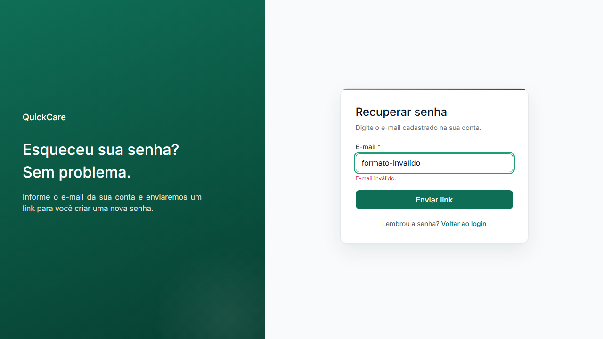
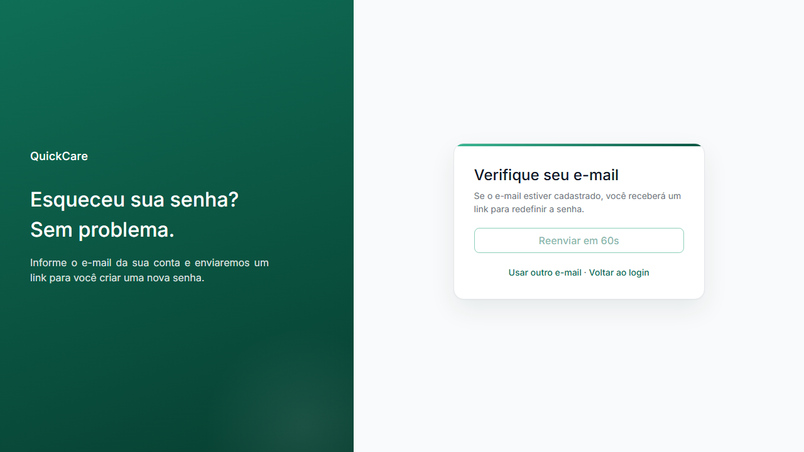
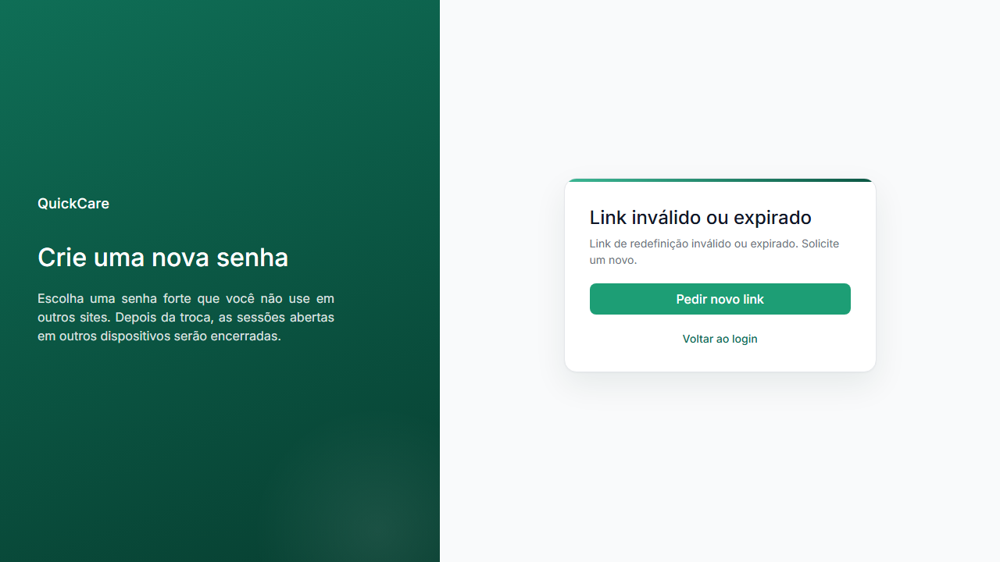
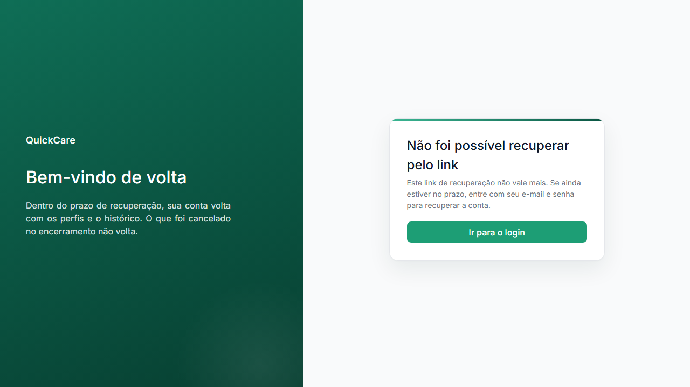

# Relatório de Execução de Testes End-to-End (E2E) — Teste 07

## 1. Identificação e Metadados da Execução

| Campo | Detalhamento |
| :--- | :--- |
| **Suíte de Teste** | `07 - Recuperação de Senha e Recuperação de Conta (@smoke)` |
| **Arquivo de Especificação** | `e2e/tests/07-recuperacao-senha-e-conta.spec.ts` |
| **Page Object Associado** | `e2e/src/pages/recuperacao.page.ts` |
| **Data da Execução** | `15/11/2026` |
| **Horário de Início (BRT / UTC-3)** | `23:49:20` (`2026-11-16T02:49:20.607Z`) |
| **Horário de Término (BRT / UTC-3)** | `23:49:32` (`2026-11-16T02:49:32.330Z`) |
| **Duração Total da Bateria** | `11,72 s` (`11.724 ms`) |
| **Ambiente Alvo** | `https://quickcare-frontend.vercel.app` · API `https://quickcare-backend-b4a4.onrender.com` |
| **Motor / Resolução** | Playwright + TypeScript · `chromium-remote` (`1280x720`) · `pt-BR` |
| **Branch Git** | `test/e2e-playwright` |
| **Responsável / Autoria** | Yasmin Feliciano Pereira Serafim de Lima |

---

## 2. Resumo Executivo dos Resultados

| Métrica | Quantidade / Valor |
| :--- | :---: |
| **Total de Casos de Teste Executados** | `3` |
| **Total de Subetapas Auditadas (`test.step`)** | `4` |
| **Aprovados (`PASSED`)** | `3` |
| **Reprovados / Ignorados** | `0` |
| **Capturas de Evidência Geradas (`.png`)** | `4` |
| **Taxa de Aprovação** | **100%** |

---

## 3. Quadro Analítico dos Casos de Teste

| ID | Caso de Teste | Passos Executados | Resultado Obtido | Tempo | Status |
| :--- | :--- | :--- | :--- | :---: | :---: |
| **CT-E2E-07.1** | Validação de e-mail e resposta neutra anti-enumeração em `/esqueci-senha` | 1. Submeter campo vazio e formato inválido (`3.247 ms`) 2. Submeter e-mail sintaticamente válido e verificar retorno neutro (`1.537 ms`) | Alertas *"Campo obrigatório."* e *"E-mail inválido."* exibidos; confirmação neutra *"Verifique seu e-mail"* apresentada sem expor existência da conta | `5,29 s` (`5.288 ms`) | **APROVADO** |
| **CT-E2E-07.2** | Bloqueio de acesso com token inválido em `/redefinir-senha` | 1. Acessar `/redefinir-senha?token=token-invalido-e2e-000` e acionar *"Pedir novo link"* (`2.004 ms`) | Exibido *"Link inválido ou expirado"* e redirecionamento para `/esqueci-senha` | `2,32 s` (`2.324 ms`) | **APROVADO** |
| **CT-E2E-07.3** | Bloqueio de link inválido em `/recuperar-conta` | 1. Acessar `/recuperar-conta?token=token-invalido-recuperacao-000` e acionar *"Ir para o login"* (`2.088 ms`) | Exibido *"Não foi possível recuperar pelo link"* e retorno seguro para `/login` | `2,46 s` (`2.464 ms`) | **APROVADO** |

---

## 4. Evidências Visuais Capturadas Automaticamente

### 4.1. CT-E2E-07.1 — Validações e Confirmação Neutra em `/esqueci-senha`

### 4.2. CT-E2E-07.2 — Token Inválido em `/redefinir-senha`

### 4.3. CT-E2E-07.3 — Token Inválido em `/recuperar-conta`

---

## 5. Artefatos Complementares
- **Relatório HTML:** `./html-report/index.html` (`npm run report:07`)
- **Log JSON:** `./resultado-execucao.json`
