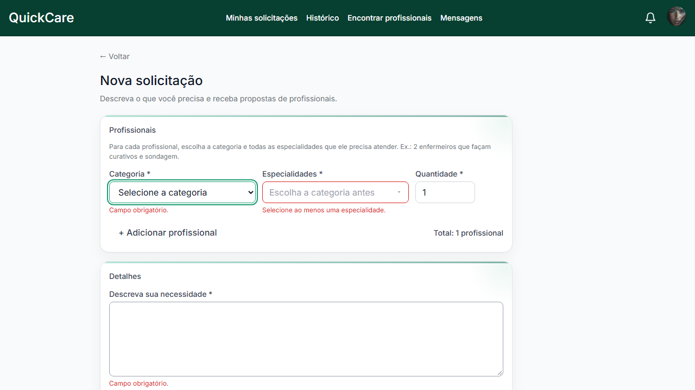
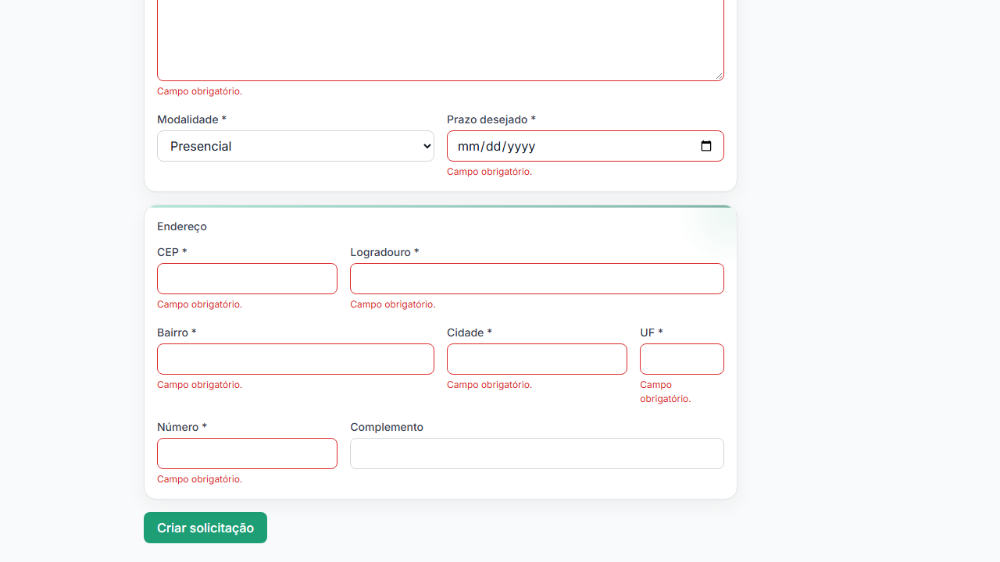
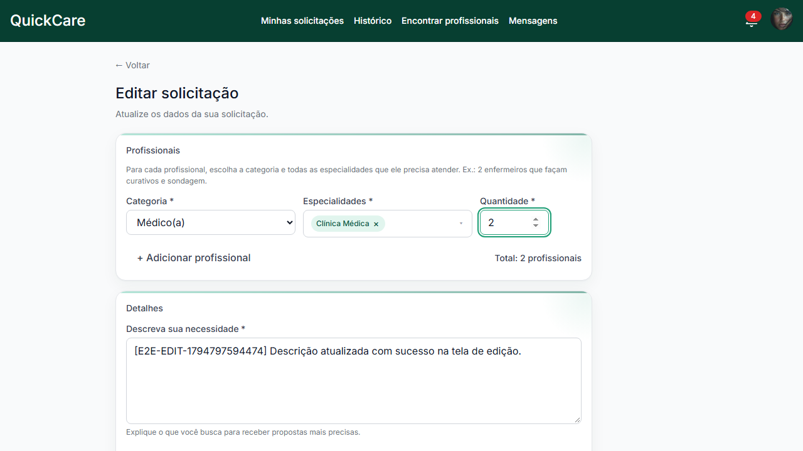
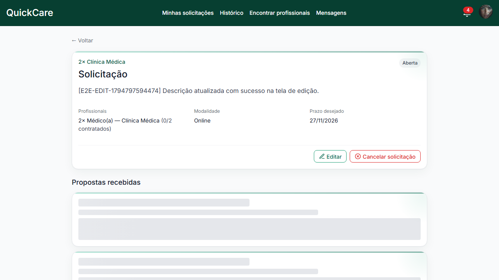

# Relatório de Execução de Testes End-to-End (E2E) — Teste 08

## 1. Identificação e Metadados da Execução

| Campo | Detalhamento |
| :--- | :--- |
| **Suíte de Teste** | `08 - Paciente: Validações e Edição de Solicitação (@auth)` |
| **Arquivo de Especificação** | `e2e/tests/08-paciente-validacao-edicao-solicitacao.spec.ts` |
| **Page Objects Associados** | `paciente.page.ts` · `login.page.ts` |
| **Data da Execução** | `15/11/2026` |
| **Horário de Início (BRT / UTC-3)** | `23:53:05` (`2026-11-16T02:53:05.755Z`) |
| **Horário de Término (BRT / UTC-3)** | `23:53:45` (`2026-11-16T02:53:45.245Z`) |
| **Duração Total da Bateria** | `39,49 s` (`39.490 ms`) |
| **Ambiente Alvo** | `https://quickcare-frontend.vercel.app` · API `https://quickcare-backend-b4a4.onrender.com` |
| **Motor / Resolução** | Playwright + TypeScript · `chromium-remote` (`1280x720`) · `pt-BR` |
| **Branch Git** | `test/e2e-playwright` |
| **Responsável / Autoria** | Yasmin Feliciano Pereira Serafim de Lima |

---

## 2. Resumo Executivo dos Resultados

| Métrica | Quantidade / Valor |
| :--- | :---: |
| **Total de Casos de Teste Executados** | `2` |
| **Total de Subetapas Auditadas (`test.step`)** | `5` |
| **Aprovados (`PASSED`)** | `2` |
| **Reprovados / Ignorados** | `0` |
| **Capturas de Evidência Geradas (`.png`)** | `4` |
| **Taxa de Aprovação** | **100%** |

---

## 3. Quadro Analítico dos Casos de Teste

| ID | Caso de Teste | Passos Executados | Resultado Obtido | Tempo | Status |
| :--- | :--- | :--- | :--- | :---: | :---: |
| **CT-E2E-08.1** | Validações obrigatórias e exigência condicional de endereço em `/patient/novo` | 1. Autenticar Paciente e submeter formulário vazio (`6.078 ms`) 2. Alternar modalidade entre *Presencial* e *Online* (`205 ms`) | Bloqueio de campos vazios confirmado; bloco de endereço ativado apenas na modalidade *Presencial* e ocultado em *Online* | `7,16 s` (`7.155 ms`) | **APROVADO** |
| **CT-E2E-08.2** | Criação, edição em `/patient/solicitacoes/:id/editar`, confirmação e autolimpeza | 1. Publicar solicitação inicial (`13.259 ms`) 2. Acionar *"Editar"*, alterar descrição/vagas para `2` e salvar (`5.704 ms`) 3. Confirmar persistência no detalhe e cancelar para autolimpeza (`11.438 ms`) | Alterações gravadas via `PUT /solicitacoes/:id`, refletidas no detalhe da solicitação e canceladas ao final | `30,64 s` (`30.636 ms`) | **APROVADO** |

---

## 4. Evidências Visuais Capturadas Automaticamente

### 4.1. CT-E2E-08.1 — Validações e Endereço Condicional em `/patient/novo`

### 4.2. CT-E2E-08.2 — Fluxo de Edição de Solicitação Aberta

---

## 5. Artefatos Complementares
- **Relatório HTML:** `./html-report/index.html` (`npm run report:08`)
- **Log JSON:** `./resultado-execucao.json`
