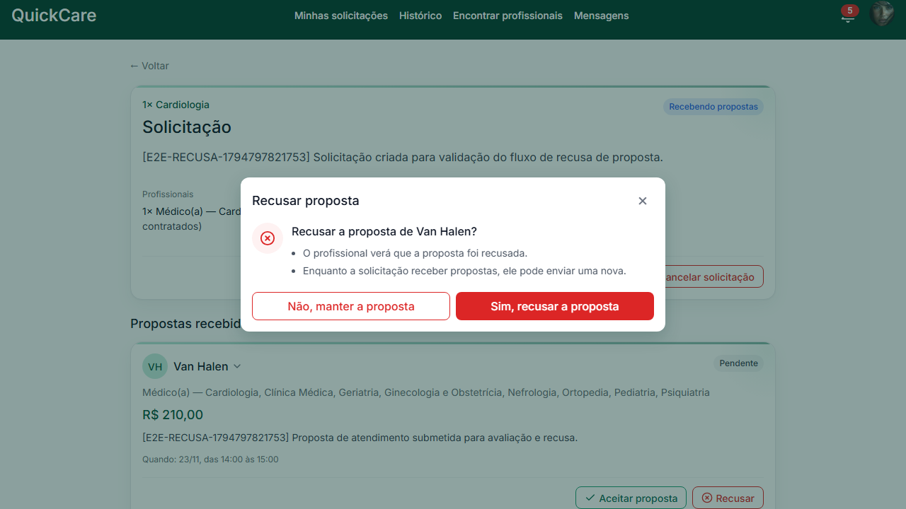
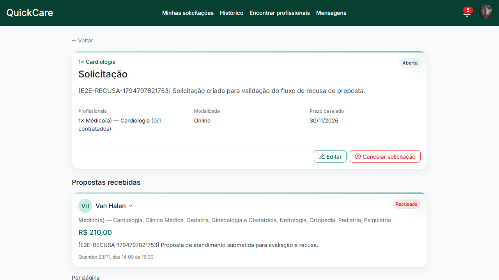
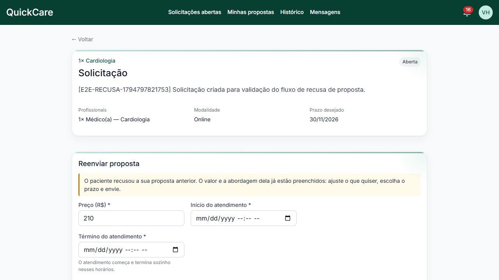

# Relatório de Execução de Testes End-to-End (E2E) — Teste 09

## 1. Identificação e Metadados da Execução

| Campo | Detalhamento |
| :--- | :--- |
| **Suíte de Teste** | `09 - Paciente: Recusa de Proposta Recebida (@fluxo)` |
| **Arquivo de Especificação** | `e2e/tests/09-paciente-recusa-proposta.spec.ts` |
| **Page Objects Associados** | `paciente.page.ts` · `profissional.page.ts` · `login.page.ts` |
| **Data da Execução** | `15/11/2026` |
| **Horário de Início (BRT / UTC-3)** | `23:56:59` (`2026-11-16T02:56:59.479Z`) |
| **Horário de Término (BRT / UTC-3)** | `23:57:59` (`2026-11-16T02:57:59.994Z`) |
| **Duração Total da Bateria** | `60,52 s` (`60.515 ms`) |
| **Ambiente Alvo** | `https://quickcare-frontend.vercel.app` · API `https://quickcare-backend-b4a4.onrender.com` |
| **Motor / Resolução** | Playwright + TypeScript · 2 Contextos Isolados · `chromium-remote` (`1280x720`) · `pt-BR` |
| **Branch Git** | `test/e2e-playwright` |
| **Responsável / Autoria** | Yasmin Feliciano Pereira Serafim de Lima |

---

## 2. Resumo Executivo dos Resultados

| Métrica | Quantidade / Valor |
| :--- | :---: |
| **Total de Casos de Teste Executados** | `1` (Jornada Multiusuário de Recusa) |
| **Total de Subetapas Auditadas (`test.step`)** | `4` |
| **Aprovados (`PASSED`)** | `1` |
| **Reprovados / Ignorados** | `0` |
| **Capturas de Evidência Geradas (`.png`)** | `3` |
| **Taxa de Aprovação** | **100%** |

---

## 3. Quadro Analítico das Etapas (`CT-E2E-09.1`)

| Etapa | Ator | Passos Executados | Resultado Obtido | Tempo | Status |
| :---: | :--- | :--- | :--- | :---: | :---: |
| **9.1** | Profissional + Paciente | Identificação de especialidade liberada e criação de solicitação pelo Paciente | Solicitação publicada e apta a receber propostas | `15,79 s` (`15.794 ms`) | **APROVADO** |
| **9.2** | Profissional | Preenchimento e submissão de proposta (`R$ 210,00`) | Proposta registrada como `Pendente` | `14,01 s` (`14.007 ms`) | **APROVADO** |
| **9.3** | Paciente | Acionamento de *"Recusar"* e confirmação no modal *"Sim, recusar a proposta"* | Proposta recusada mantendo a vaga aberta para outros candidatos | `13,63 s` (`13.627 ms`) | **APROVADO** |
| **9.4** | Profissional + Paciente | Verificação do aviso na visão do Profissional e cancelamento de autolimpeza | Exibido *"O paciente recusou a sua proposta anterior"* com opção de reenvio; solicitação higienizada | `13,04 s` (`13.039 ms`) | **APROVADO** |

---

## 4. Evidências Visuais Capturadas Automaticamente

### 4.1. Modal de Confirmação e Estado Pós-Recusa (Visão Paciente)

### 4.2. Aviso de Recusa e Opção de Reenvio (Visão Profissional)

---

## 5. Artefatos Complementares
- **Relatório HTML:** `./html-report/index.html` (`npm run report:09`)
- **Log JSON:** `./resultado-execucao.json`
