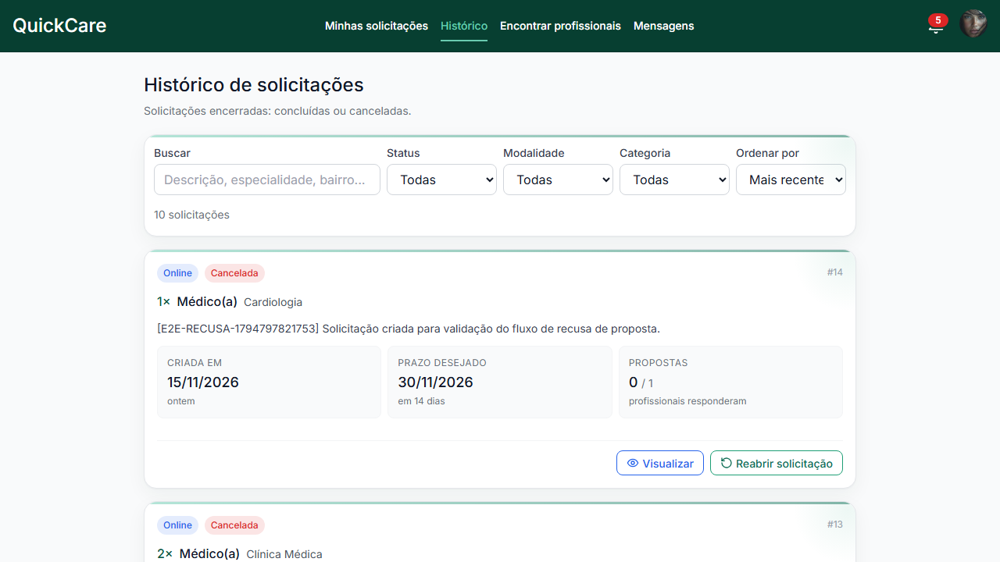
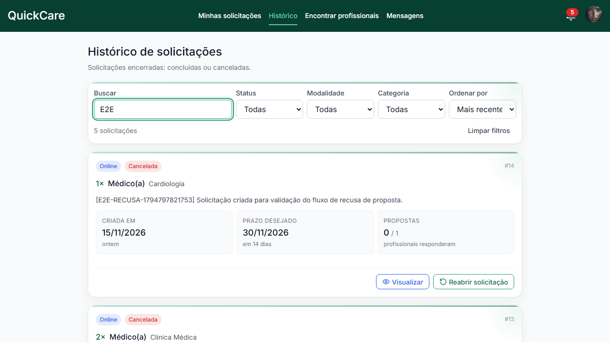
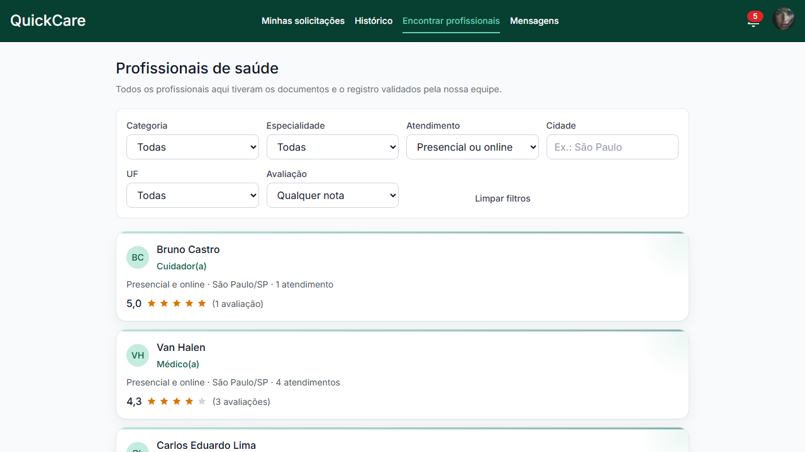
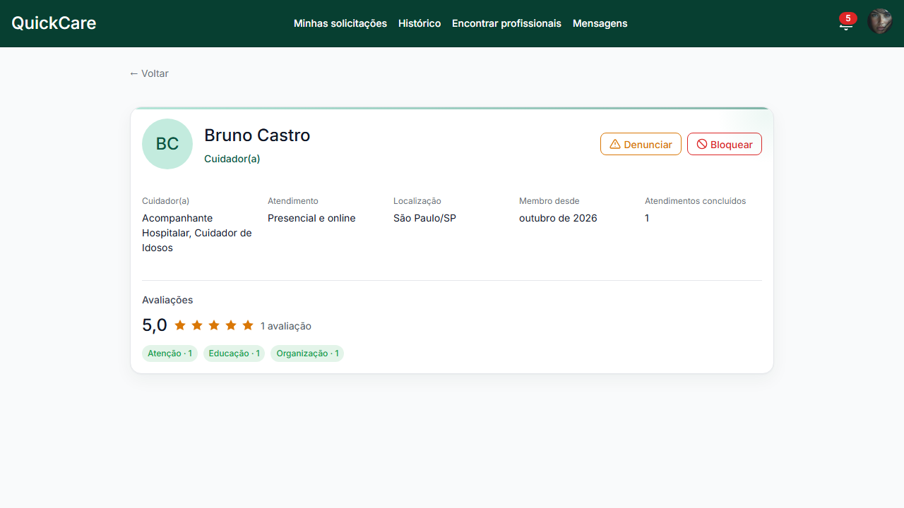

# Relatório de Execução de Testes End-to-End (E2E) — Teste 10

## 1. Identificação e Metadados da Execução

| Campo | Detalhamento |
| :--- | :--- |
| **Suíte de Teste** | `10 - Paciente: Histórico e Busca Interna de Profissionais (@auth)` |
| **Arquivo de Especificação** | `e2e/tests/10-paciente-historico-e-busca-profissionais.spec.ts` |
| **Page Object Associado** | `e2e/src/pages/login.page.ts` |
| **Data da Execução** | `16/11/2026` |
| **Horário de Início (BRT / UTC-3)** | `00:00:26` (`2026-11-16T03:00:26.715Z`) |
| **Horário de Término (BRT / UTC-3)** | `00:00:55` (`2026-11-16T03:00:55.078Z`) |
| **Duração Total da Bateria** | `28,36 s` (`28.363 ms`) |
| **Ambiente Alvo** | `https://quickcare-frontend.vercel.app` · API `https://quickcare-backend-b4a4.onrender.com` |
| **Motor / Resolução** | Playwright + TypeScript · `chromium-remote` (`1280x720`) · `pt-BR` |
| **Branch Git** | `test/e2e-playwright` |
| **Responsável / Autoria** | Yasmin Feliciano Pereira Serafim de Lima |

---

## 2. Resumo Executivo dos Resultados

| Métrica | Quantidade / Valor |
| :--- | :---: |
| **Total de Casos de Teste Executados** | `2` |
| **Total de Subetapas Auditadas (`test.step`)** | `3` |
| **Aprovados (`PASSED`)** | `2` |
| **Reprovados / Ignorados** | `0` |
| **Capturas de Evidência Geradas (`.png`)** | `4` |
| **Taxa de Aprovação** | **100%** |

---

## 3. Quadro Analítico dos Casos de Teste

| ID | Caso de Teste | Passos Executados | Resultado Obtido | Tempo | Status |
| :--- | :--- | :--- | :--- | :---: | :---: |
| **CT-E2E-10.1** | Histórico de solicitações encerradas e filtragem em `/patient/historico` | 1. Autenticar Paciente e abrir `/patient/historico` (`6.982 ms`) 2. Filtrar pelo termo `E2E` e acionar *"Limpar filtros"* (`600 ms`) | Histórico carregado com solicitações encerradas/canceladas, filtro aplicado e restaurado corretamente | `8,18 s` (`8.181 ms`) | **APROVADO** |
| **CT-E2E-10.2** | Busca interna `/patient/profissionais` e perfil do profissional com controles de moderação | 1. Acessar `/patient/profissionais`, selecionar o primeiro profissional e abrir `/patient/profissionais/:id` (`18.494 ms`) | Listagem interna carregada e ficha do profissional exibida com detalhes, avaliações e componente de bloqueio | `18,76 s` (`18.761 ms`) | **APROVADO** |

---

## 4. Evidências Visuais Capturadas Automaticamente

### 4.1. CT-E2E-10.1 — Histórico de Solicitações e Filtro

### 4.2. CT-E2E-10.2 — Busca Interna e Perfil do Profissional Logado

---

## 5. Artefatos Complementares
- **Relatório HTML:** `./html-report/index.html` (`npm run report:10`)
- **Log JSON:** `./resultado-execucao.json`
