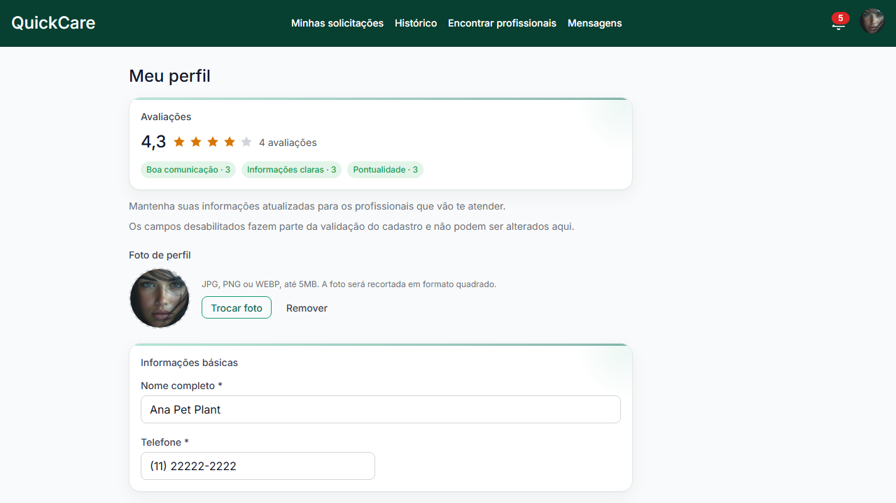
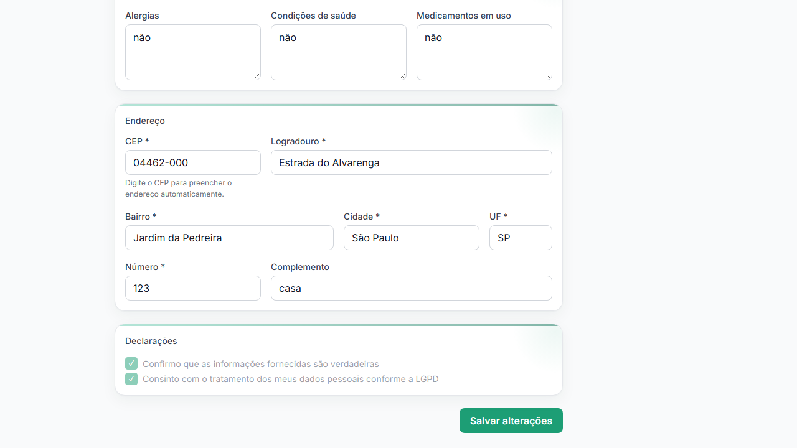
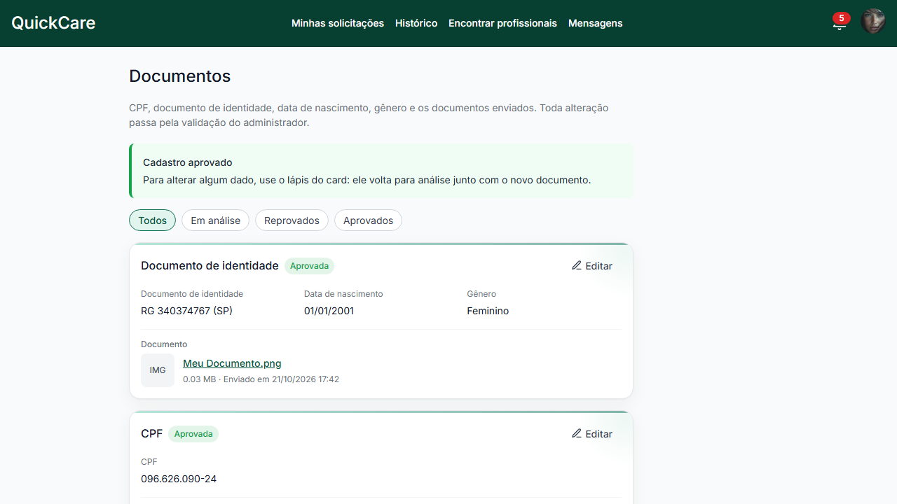
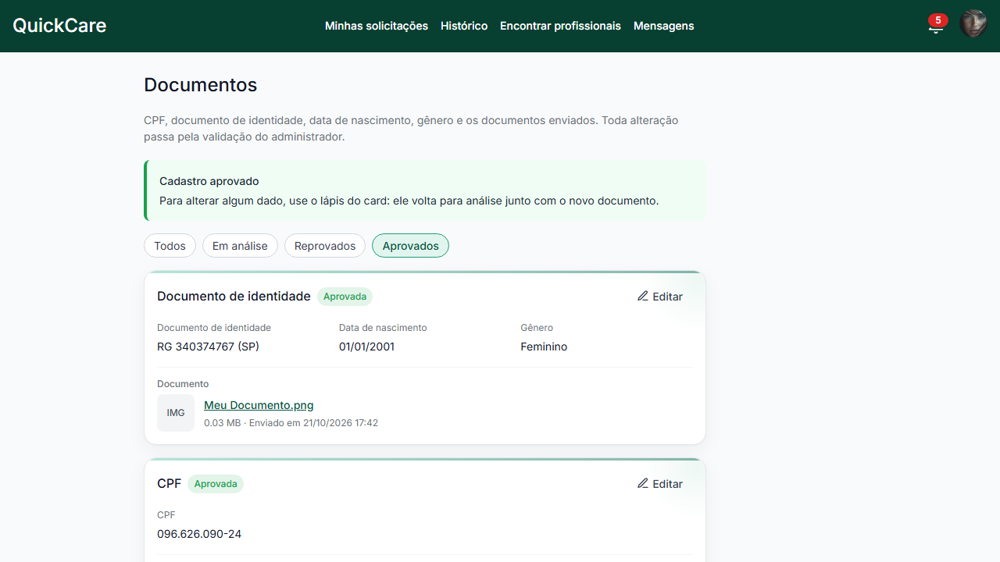

# Relatório de Execução de Testes End-to-End (E2E) — Teste 11

## 1. Identificação e Metadados da Execução

| Campo | Detalhamento |
| :--- | :--- |
| **Suíte de Teste** | `11 - Paciente: Meu Perfil e Documentos Cadastrais (@auth)` |
| **Arquivo de Especificação** | `e2e/tests/11-paciente-meu-perfil-e-documentos.spec.ts` |
| **Page Object Associado** | `e2e/src/pages/login.page.ts` |
| **Data da Execução** | `16/11/2026` |
| **Horário de Início (BRT / UTC-3)** | `00:03:35` (`2026-11-16T03:03:35.946Z`) |
| **Horário de Término (BRT / UTC-3)** | `00:03:51` (`2026-11-16T03:03:51.898Z`) |
| **Duração Total da Bateria** | `15,95 s` (`15.952 ms`) |
| **Ambiente Alvo** | `https://quickcare-frontend.vercel.app` · API `https://quickcare-backend-b4a4.onrender.com` |
| **Motor / Resolução** | Playwright + TypeScript · `chromium-remote` (`1280x720`) · `pt-BR` |
| **Branch Git** | `test/e2e-playwright` |
| **Responsável / Autoria** | Yasmin Feliciano Pereira Serafim de Lima |

---

## 2. Resumo Executivo dos Resultados

| Métrica | Quantidade / Valor |
| :--- | :---: |
| **Total de Casos de Teste Executados** | `2` |
| **Total de Subetapas Auditadas (`test.step`)** | `4` |
| **Aprovados (`PASSED`)** | `2` |
| **Reprovados / Ignorados** | `0` |
| **Capturas de Evidência Geradas (`.png`)** | `4` |
| **Taxa de Aprovação** | **100%** |

---

## 3. Quadro Analítico dos Casos de Teste

| ID | Caso de Teste | Passos Executados | Resultado Obtido | Tempo | Status |
| :--- | :--- | :--- | :--- | :---: | :---: |
| **CT-E2E-11.1** | Carregamento de `/patient/perfil` e travamento das declarações LGPD | 1. Autenticar Paciente e abrir `/patient/perfil` pelo menu da conta (`5.717 ms`) 2. Validar cartões de emergência, saúde, endereço e declarações desabilitadas (`230 ms`) | Dados pessoais carregados com sucesso e checkboxes de veracidade/LGPD protegidas (`disabled`) após aprovação | `6,59 s` (`6.585 ms`) | **APROVADO** |
| **CT-E2E-11.2** | Visualização e filtragem de etapas em `/patient/documentos` | 1. Acessar `/patient/documentos` e validar resumo e cards de etapas (`6.975 ms`) 2. Alternar chips *Aprovados* e *Todos* (`419 ms`) | Situação cadastral consolidada e filtros de etapas documentais operando sem falhas | `7,68 s` (`7.678 ms`) | **APROVADO** |

---

## 4. Evidências Visuais Capturadas Automaticamente

### 4.1. CT-E2E-11.1 — Meu Perfil do Paciente e Declarações Travadas

### 4.2. CT-E2E-11.2 — Documentos e Filtro de Etapas Validadas

---

## 5. Artefatos Complementares
- **Relatório HTML:** `./html-report/index.html` (`npm run report:11`)
- **Log JSON:** `./resultado-execucao.json`
