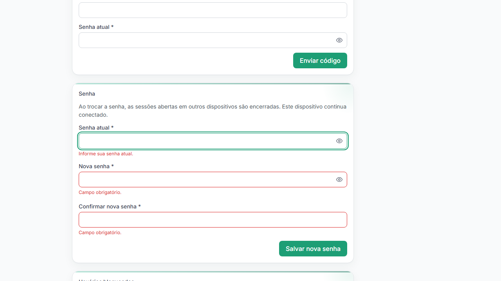
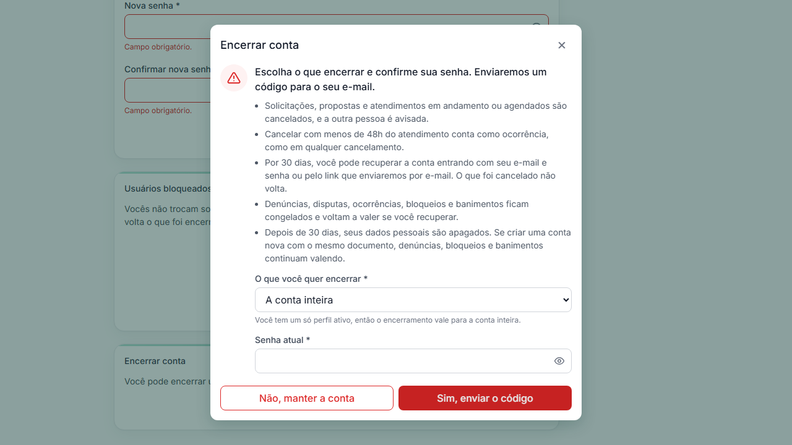
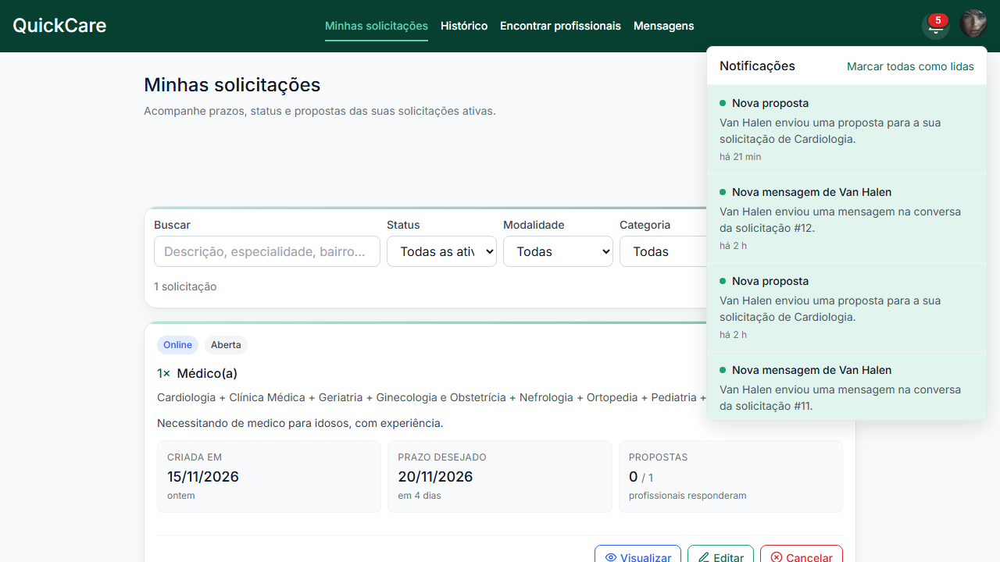
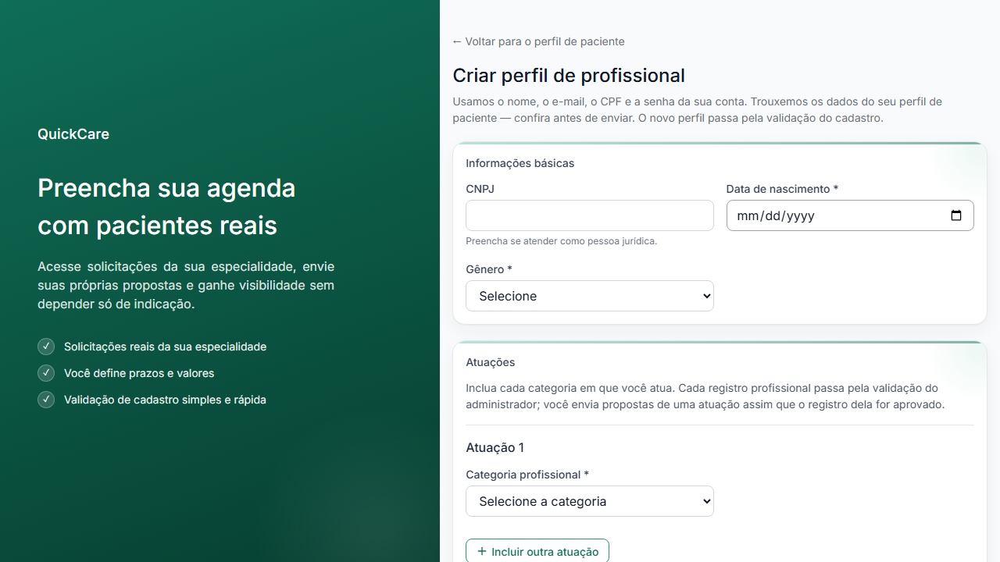

# Relatório de Execução de Testes End-to-End (E2E) — Teste 12

## 1. Identificação e Metadados da Execução

| Campo | Detalhamento |
| :--- | :--- |
| **Suíte de Teste** | `12 - Paciente: Segurança, Bloqueios, Notificações e 2º Perfil (@auth)` |
| **Arquivo de Especificação** | `e2e/tests/12-paciente-seguranca-notificacoes-novo-perfil.spec.ts` |
| **Page Object Associado** | `e2e/src/pages/login.page.ts` |
| **Data da Execução** | `16/11/2026` |
| **Horário de Início (BRT / UTC-3)** | `00:19:06` (`2026-11-16T03:19:06.918Z`) |
| **Horário de Término (BRT / UTC-3)** | `00:19:23` (`2026-11-16T03:19:23.277Z`) |
| **Duração Total da Bateria** | `16,36 s` (`16.360 ms`) |
| **Ambiente Alvo** | `https://quickcare-frontend.vercel.app` · API `https://quickcare-backend-b4a4.onrender.com` |
| **Motor / Resolução** | Playwright + TypeScript · `chromium-remote` (`1280x720`) · `pt-BR` |
| **Branch Git** | `test/e2e-playwright` |
| **Responsável / Autoria** | Yasmin Feliciano Pereira Serafim de Lima |

---

## 2. Resumo Executivo dos Resultados

| Métrica | Quantidade / Valor |
| :--- | :---: |
| **Total de Casos de Teste Executados** | `2` |
| **Total de Subetapas Auditadas (`test.step`)** | `4` |
| **Aprovados (`PASSED`)** | `2` |
| **Reprovados / Ignorados** | `0` |
| **Capturas de Evidência Geradas (`.png`)** | `4` |
| **Taxa de Aprovação** | **100%** |

---

## 3. Quadro Analítico dos Casos de Teste

| ID | Caso de Teste | Passos Executados | Resultado Obtido | Tempo | Status |
| :--- | :--- | :--- | :--- | :---: | :---: |
| **CT-E2E-12.1** | Validações em `/patient/seguranca`, bloqueios e modal de encerramento seguro | 1. Acessar `/patient/seguranca` e validar troca de e-mail/senha e lista de bloqueados (`8.085 ms`) 2. Abrir e fechar diálogo de encerramento sem confirmar (`328 ms`) | Mensagem *"Informe sua senha atual."* validada, seção *Usuários bloqueados* visível e diálogo de encerramento protegido por senha | `8,97 s` (`8.970 ms`) | **APROVADO** |
| **CT-E2E-12.2** | Sino de notificações e expansão para segundo perfil (`/criar-perfil/profissional`) | 1. Abrir painel suspenso de notificações no cabeçalho (`4.889 ms`) 2. Acionar *"Quero atender como profissional"* no menu da conta (`418 ms`) | Painel de notificações aberto e rota `/criar-perfil/profissional` carregada reaproveitando dados da conta | `5,61 s` (`5.612 ms`) | **APROVADO** |

---

## 4. Evidências Visuais Capturadas Automaticamente

### 4.1. CT-E2E-12.1 — Segurança, Senha e Modal Protegido de Encerramento

### 4.2. CT-E2E-12.2 — Painel de Notificações e Expansão para Multiconta

---

## 5. Artefatos Complementares
- **Relatório HTML:** `./html-report/index.html` (`npm run report:12`)
- **Log JSON:** `./resultado-execucao.json`
