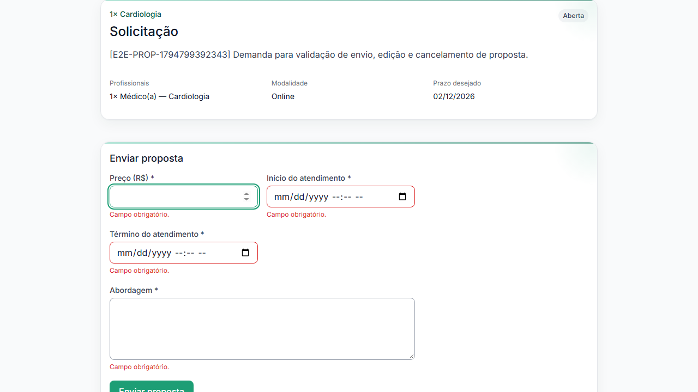
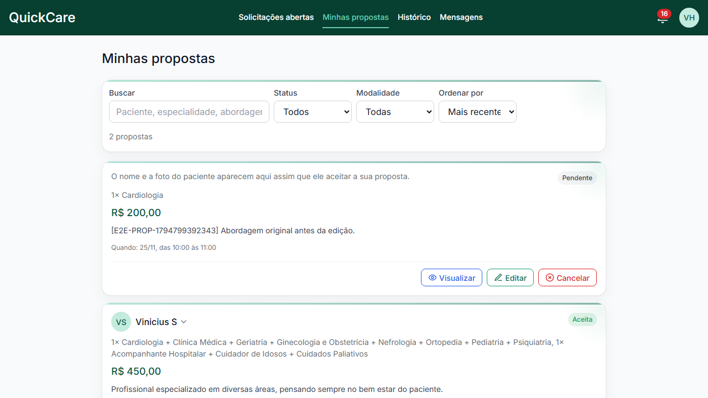
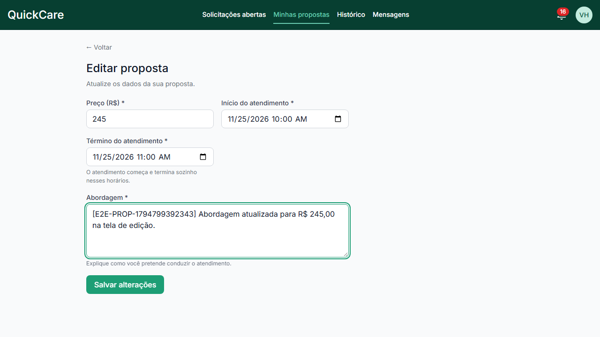
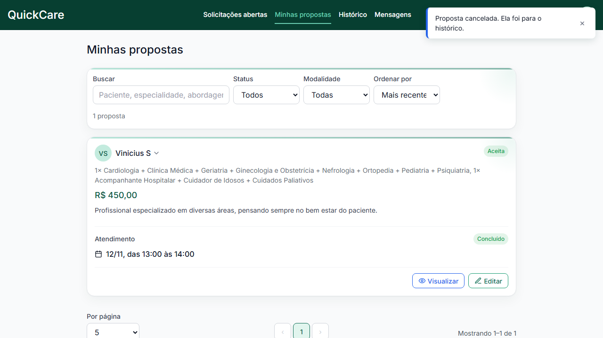

# Relatório de Execução de Testes End-to-End (E2E) — Teste 13

## 1. Identificação e Metadados da Execução

| Campo | Detalhamento |
| :--- | :--- |
| **Suíte de Teste** | `13 - Profissional: Gestão de Propostas (Validar, Enviar, Editar e Cancelar) (@fluxo)` |
| **Arquivo de Especificação** | `e2e/tests/13-profissional-gestao-propostas.spec.ts` |
| **Page Objects Associados** | `profissional.page.ts` · `paciente.page.ts` · `login.page.ts` |
| **Data da Execução** | `16/11/2026` |
| **Horário de Início (BRT / UTC-3)** | `00:23:10` (`2026-11-16T03:23:10.455Z`) |
| **Horário de Término (BRT / UTC-3)** | `00:24:24` (`2026-11-16T03:24:24.099Z`) |
| **Duração Total da Bateria** | `73,64 s` (`73.645 ms`) |
| **Ambiente Alvo** | `https://quickcare-frontend.vercel.app` · API `https://quickcare-backend-b4a4.onrender.com` |
| **Motor / Resolução** | Playwright + TypeScript · 2 Contextos Isolados · `chromium-remote` (`1280x720`) · `pt-BR` |
| **Branch Git** | `test/e2e-playwright` |
| **Responsável / Autoria** | Yasmin Feliciano Pereira Serafim de Lima |

---

## 2. Resumo Executivo dos Resultados

| Métrica | Quantidade / Valor |
| :--- | :---: |
| **Total de Casos de Teste Executados** | `1` (Ciclo Completo de Proposta do Profissional) |
| **Total de Subetapas Auditadas (`test.step`)** | `4` |
| **Aprovados (`PASSED`)** | `1` |
| **Reprovados / Ignorados** | `0` |
| **Capturas de Evidência Geradas (`.png`)** | `4` |
| **Taxa de Aprovação** | **100%** |

---

## 3. Quadro Analítico das Etapas (`CT-E2E-13.1`)

| Etapa | Ator | Passos Executados | Resultado Obtido | Tempo | Status |
| :---: | :--- | :--- | :--- | :---: | :---: |
| **13.1** | Profissional + Paciente | Identificação de atuação liberada e criação de solicitação compatível | Solicitação publicada aguardando propostas | `16,04 s` (`16.044 ms`) | **APROVADO** |
| **13.2** | Profissional | Tentativa de envio vazio seguida de submissão válida (`R$ 200,00`) | Erros obrigatórios validados e proposta inicial registrada | `21,98 s` (`21.984 ms`) | **APROVADO** |
| **13.3** | Profissional | Acesso a `/professional/propostas`, abertura de `/editar` e atualização para `R$ 245,00` | Alterações gravadas e refletidas imediatamente em *Minhas propostas* | `20,89 s` (`20.892 ms`) | **APROVADO** |
| **13.4** | Profissional + Paciente | Cancelamento da proposta pendente pelo Profissional e autolimpeza da solicitação | Proposta cancelada e movida ao histórico; solicitação higienizada | `11,18 s` (`11.182 ms`) | **APROVADO** |

---

## 4. Evidências Visuais Capturadas Automaticamente

### 4.1. Validação Obrigatória e Listagem em Minhas Propostas

### 4.2. Edição (`/editar`) e Cancelamento pelo Profissional

---

## 5. Artefatos Complementares
- **Relatório HTML:** `./html-report/index.html` (`npm run report:13`)
- **Log JSON:** `./resultado-execucao.json`
