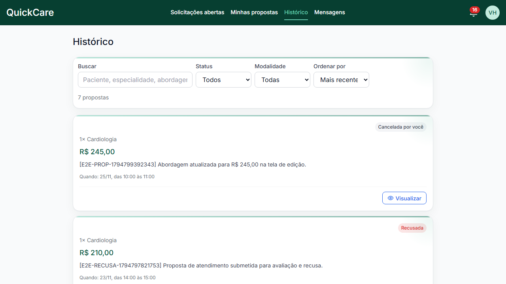
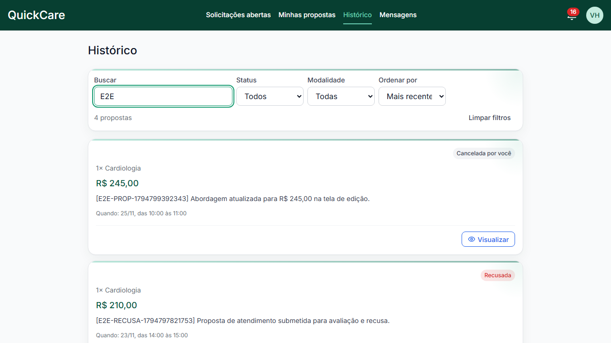
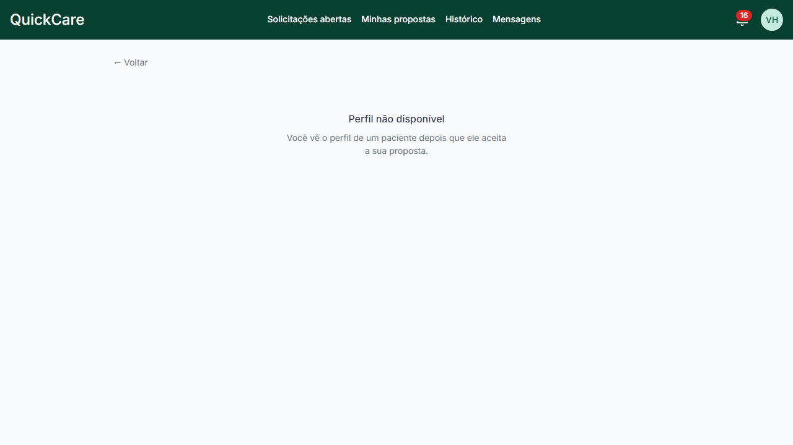

# Relatório de Execução de Testes End-to-End (E2E) — Teste 14

## 1. Identificação e Metadados da Execução

| Campo | Detalhamento |
| :--- | :--- |
| **Suíte de Teste** | `14 - Profissional: Histórico e Visualização do Perfil do Paciente (@auth)` |
| **Arquivo de Especificação** | `e2e/tests/14-profissional-historico-e-perfil-paciente.spec.ts` |
| **Data da Execução** | `16/11/2026` |
| **Horário de Início (BRT / UTC-3)** | `00:39:23` (`2026-11-16T03:39:23.492Z`) |
| **Horário de Término (BRT / UTC-3)** | `00:39:46` (`2026-11-16T03:39:46.268Z`) |
| **Duração Total da Bateria** | `22,78 s` (`22.776 ms`) |
| **Ambiente Alvo** | `https://quickcare-frontend.vercel.app` · API `https://quickcare-backend-b4a4.onrender.com` |
| **Motor / Resolução** | Playwright + TypeScript · `chromium-remote` (`1280x720`) · `pt-BR` |
| **Branch Git** | `test/e2e-playwright` |
| **Responsável / Autoria** | Yasmin Feliciano Pereira Serafim de Lima |

---

## 2. Resumo Executivo dos Resultados

| Métrica | Quantidade / Valor |
| :--- | :---: |
| **Total de Casos de Teste Executados** | `2` |
| **Total de Subetapas Auditadas (`test.step`)** | `4` |
| **Aprovados (`PASSED`)** | `2` |
| **Reprovados / Ignorados** | `0` |
| **Capturas de Evidência Geradas (`.png`)** | `3` |
| **Taxa de Aprovação** | **100%** |

---

## 3. Quadro Analítico dos Casos de Teste

| ID | Caso de Teste | Passos Executados | Resultado Obtido | Tempo | Status |
| :--- | :--- | :--- | :--- | :---: | :---: |
| **CT-E2E-14.1** | deve carregar o Histórico de propostas encerradas em /professional/historico e aplicar filtros | 1. Autenticar Profissional e acessar /professional/historico (`13.825 ms`) 2. Filtrar histórico textual e restaurar listagem em Limpar filtros (`537 ms`) | Validações concluídas com êxito sem divergências | `14,91 s` (`14.915 ms`) | **APROVADO** |
| **CT-E2E-14.2** | deve proteger /professional/pacientes/:id sem vínculo e abrir o perfil de paciente com proposta aceita | 1. Validar bloqueio de sigilo ao tentar acessar ID de paciente sem aceite (/professional/pacientes/999999999) (`5.384 ms`) 2. Localizar paciente com histórico de aceite e abrir seu perfil em /professional/pacientes/:id (`212 ms`) | Validações concluídas com êxito sem divergências | `5,91 s` (`5.908 ms`) | **APROVADO** |

---

## 4. Evidências Visuais Capturadas Automaticamente

### CT-E2E-14.1 — deve carregar o Histórico de propostas encerradas em /professional/historico e aplicar filtros

#### Aba Histórico do Profissional listando propostas recusadas, canceladas ou concluídas

#### Filtro textual aplicado ao histórico de propostas do Profissional

### CT-E2E-14.2 — deve proteger /professional/pacientes/:id sem vínculo e abrir o perfil de paciente com proposta aceita

#### Proteção de privacidade impedindo acesso a perfil de paciente sem proposta aceita

---

## 5. Artefatos Complementares
- **Relatório HTML:** `./html-report/index.html` (`npm run report:14`)
- **Log JSON:** `./resultado-execucao.json`
