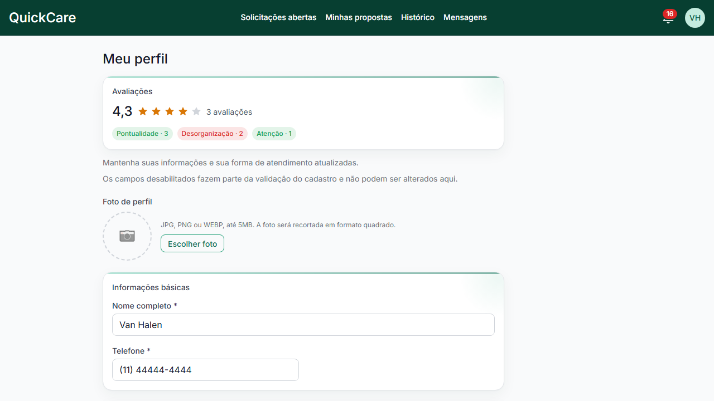
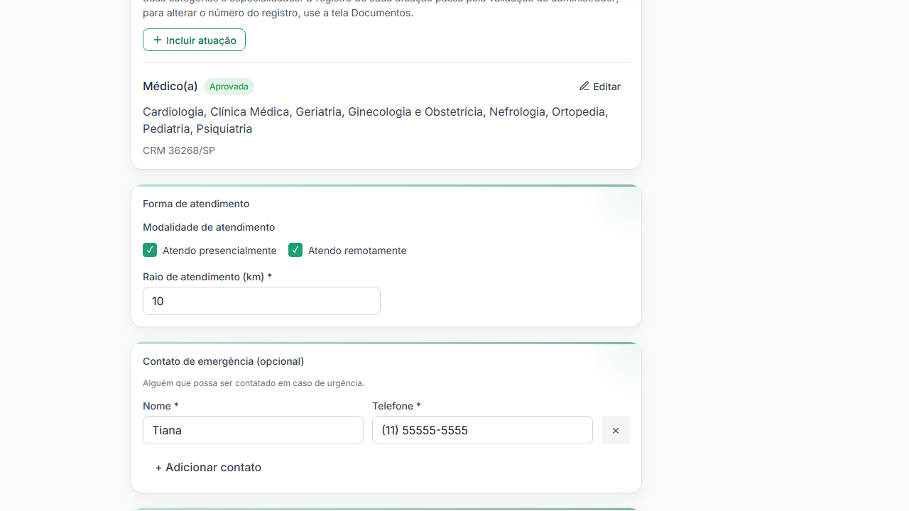
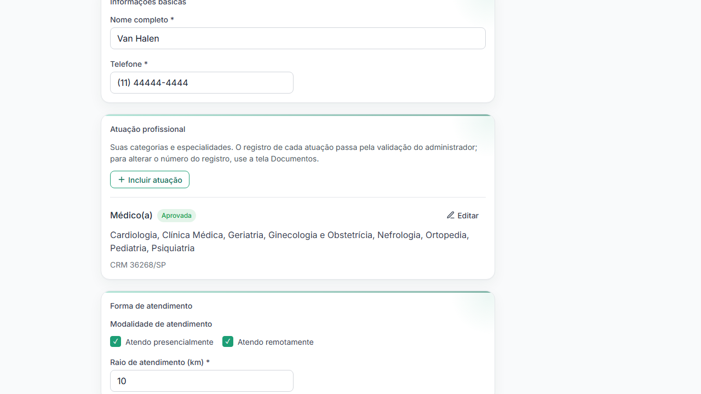
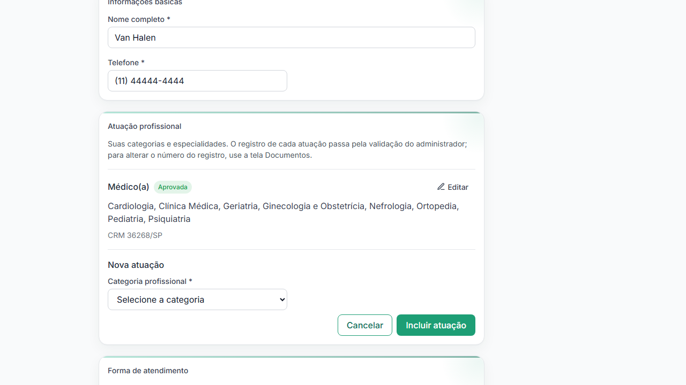

# Relatório de Execução de Testes End-to-End (E2E) — Teste 15

## 1. Identificação e Metadados da Execução

| Campo | Detalhamento |
| :--- | :--- |
| **Suíte de Teste** | `15 - Profissional: Meu Perfil e Áreas de Atuação (@auth)` |
| **Arquivo de Especificação** | `e2e/tests/15-profissional-meu-perfil-e-atuacoes.spec.ts` |
| **Data da Execução** | `16/11/2026` |
| **Horário de Início (BRT / UTC-3)** | `00:39:53` (`2026-11-16T03:39:53.582Z`) |
| **Horário de Término (BRT / UTC-3)** | `00:40:11` (`2026-11-16T03:40:11.532Z`) |
| **Duração Total da Bateria** | `17,95 s` (`17.951 ms`) |
| **Ambiente Alvo** | `https://quickcare-frontend.vercel.app` · API `https://quickcare-backend-b4a4.onrender.com` |
| **Motor / Resolução** | Playwright + TypeScript · `chromium-remote` (`1280x720`) · `pt-BR` |
| **Branch Git** | `test/e2e-playwright` |
| **Responsável / Autoria** | Yasmin Feliciano Pereira Serafim de Lima |

---

## 2. Resumo Executivo dos Resultados

| Métrica | Quantidade / Valor |
| :--- | :---: |
| **Total de Casos de Teste Executados** | `2` |
| **Total de Subetapas Auditadas (`test.step`)** | `3` |
| **Aprovados (`PASSED`)** | `2` |
| **Reprovados / Ignorados** | `0` |
| **Capturas de Evidência Geradas (`.png`)** | `4` |
| **Taxa de Aprovação** | **100%** |

---

## 3. Quadro Analítico dos Casos de Teste

| ID | Caso de Teste | Passos Executados | Resultado Obtido | Tempo | Status |
| :--- | :--- | :--- | :--- | :---: | :---: |
| **CT-E2E-15.1** | deve carregar Meu perfil (/professional/perfil) com modalidade, endereço e seguro profissional | 1. Autenticar Profissional e acessar /professional/perfil (`7.503 ms`) 2. Validar cartões de forma de atendimento, endereço e declaração de seguro profissional (`213 ms`) | Validações concluídas com êxito sem divergências | `8,33 s` (`8.328 ms`) | **APROVADO** |
| **CT-E2E-15.2** | deve exibir o gerenciador de Atuação profissional e permitir abrir e cancelar inclusão sem sujar dados | 1. Inspecionar atuações cadastradas e testar abertura/cancelamento de Nova atuação (`7.860 ms`) | Validações concluídas com êxito sem divergências | `8,10 s` (`8.098 ms`) | **APROVADO** |

---

## 4. Evidências Visuais Capturadas Automaticamente

### CT-E2E-15.1 — deve carregar Meu perfil (/professional/perfil) com modalidade, endereço e seguro profissional

#### Tela Meu perfil do Profissional com resumo de avaliações e informações básicas

#### Configuração de modalidade de atendimento e raio geográfico em Meu perfil

### CT-E2E-15.2 — deve exibir o gerenciador de Atuação profissional e permitir abrir e cancelar inclusão sem sujar dados

#### Gerenciador de Atuação profissional listando categorias, especialidades e status do registro

#### Formulário de inclusão de nova área de atuação aberto no perfil do Profissional

---

## 5. Artefatos Complementares
- **Relatório HTML:** `./html-report/index.html` (`npm run report:15`)
- **Log JSON:** `./resultado-execucao.json`
