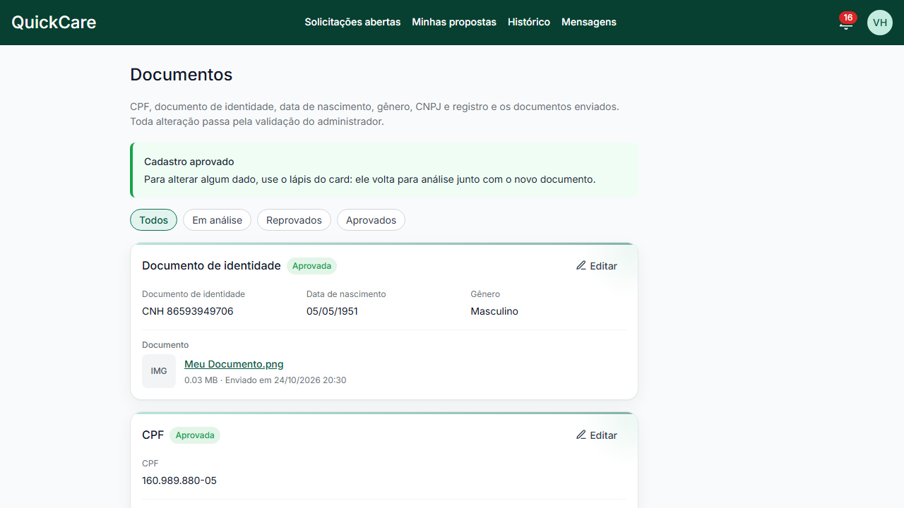
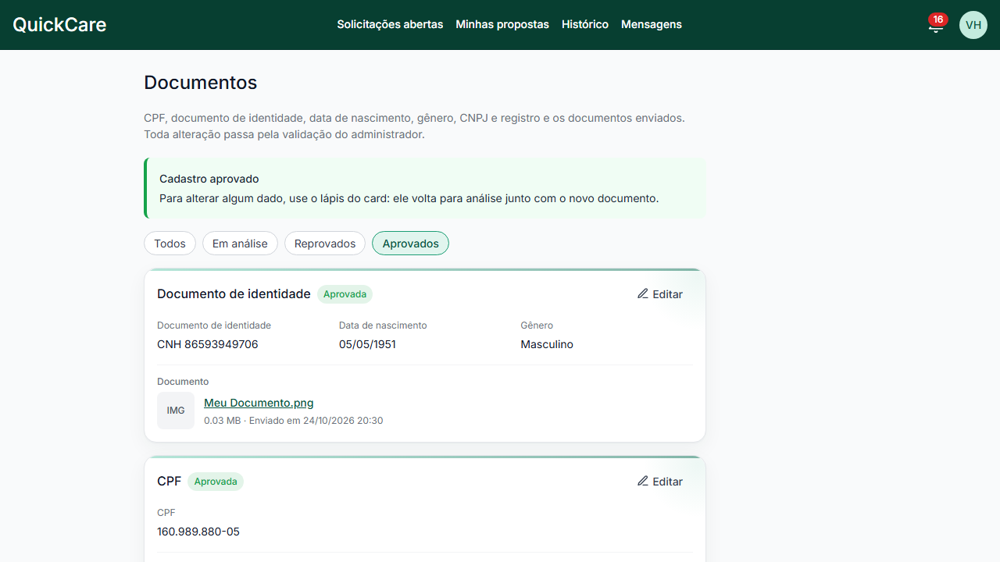
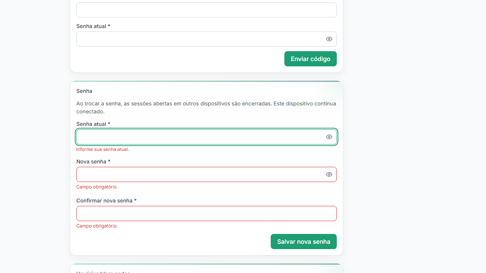
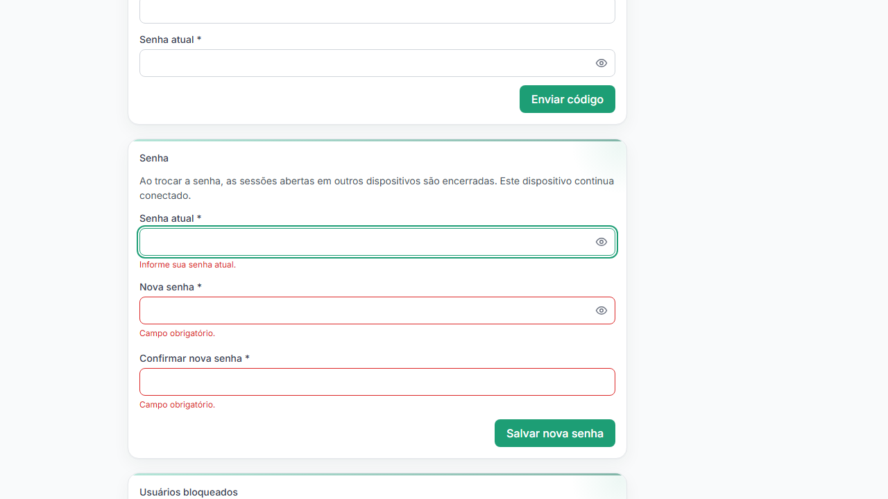

# Relatório de Execução de Testes End-to-End (E2E) — Teste 16

## 1. Identificação e Metadados da Execução

| Campo | Detalhamento |
| :--- | :--- |
| **Suíte de Teste** | `16 - Profissional: Documentos Regulatórios e Segurança (@auth)` |
| **Arquivo de Especificação** | `e2e/tests/16-profissional-documentos-e-seguranca.spec.ts` |
| **Data da Execução** | `16/11/2026` |
| **Horário de Início (BRT / UTC-3)** | `00:40:20` (`2026-11-16T03:40:20.070Z`) |
| **Horário de Término (BRT / UTC-3)** | `00:40:36` (`2026-11-16T03:40:36.222Z`) |
| **Duração Total da Bateria** | `16,15 s` (`16.153 ms`) |
| **Ambiente Alvo** | `https://quickcare-frontend.vercel.app` · API `https://quickcare-backend-b4a4.onrender.com` |
| **Motor / Resolução** | Playwright + TypeScript · `chromium-remote` (`1280x720`) · `pt-BR` |
| **Branch Git** | `test/e2e-playwright` |
| **Responsável / Autoria** | Yasmin Feliciano Pereira Serafim de Lima |

---

## 2. Resumo Executivo dos Resultados

| Métrica | Quantidade / Valor |
| :--- | :---: |
| **Total de Casos de Teste Executados** | `2` |
| **Total de Subetapas Auditadas (`test.step`)** | `2` |
| **Aprovados (`PASSED`)** | `2` |
| **Reprovados / Ignorados** | `0` |
| **Capturas de Evidência Geradas (`.png`)** | `4` |
| **Taxa de Aprovação** | **100%** |

---

## 3. Quadro Analítico dos Casos de Teste

| ID | Caso de Teste | Passos Executados | Resultado Obtido | Tempo | Status |
| :--- | :--- | :--- | :--- | :---: | :---: |
| **CT-E2E-16.1** | deve carregar Documentos (/professional/documentos) exibindo registro profissional e filtros de validação | 1. Autenticar Profissional, acessar /professional/documentos e alternar filtros de status (`6.851 ms`) | Validações concluídas com êxito sem divergências | `7,49 s` (`7.490 ms`) | **APROVADO** |
| **CT-E2E-16.2** | deve carregar Segurança (/professional/seguranca) e validar proteção de troca de senha e lista de bloqueados | 1. Acessar /professional/seguranca e validar seções de e-mail, senha e usuários bloqueados (`6.927 ms`) | Validações concluídas com êxito sem divergências | `7,12 s` (`7.118 ms`) | **APROVADO** |

---

## 4. Evidências Visuais Capturadas Automaticamente

### CT-E2E-16.1 — deve carregar Documentos (/professional/documentos) exibindo registro profissional e filtros de validação

#### Página Documentos do Profissional com etapas de CPF, identidade e registro do conselho

#### Etapas documentais do Profissional filtradas pelo status Aprovados

### CT-E2E-16.2 — deve carregar Segurança (/professional/seguranca) e validar proteção de troca de senha e lista de bloqueados

#### Validação obrigatória de senha atual em /professional/seguranca

#### Seção de gestão de usuários bloqueados e encerramento de conta do Profissional

---

## 5. Artefatos Complementares
- **Relatório HTML:** `./html-report/index.html` (`npm run report:16`)
- **Log JSON:** `./resultado-execucao.json`
