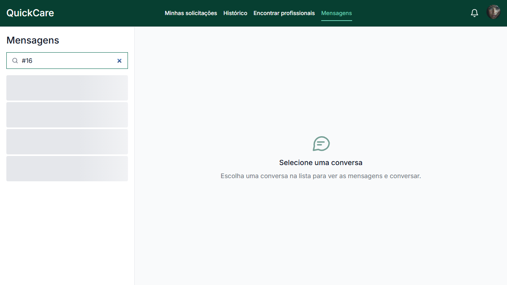
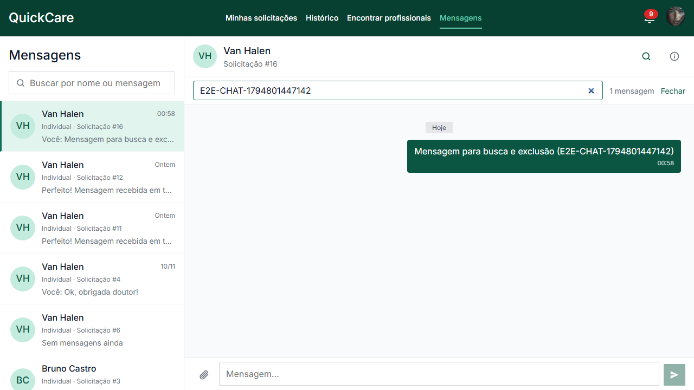
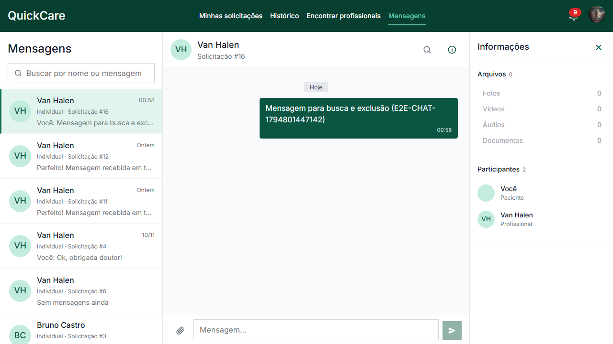
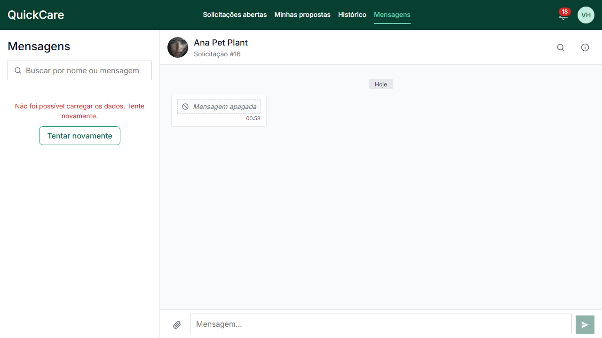

# Relatório de Execução de Testes End-to-End (E2E) — Teste 17

## 1. Identificação e Metadados da Execução

| Campo | Detalhamento |
| :--- | :--- |
| **Suíte de Teste** | `17 - Central de Mensagens e Recursos Avançados do Chat (@fluxo)` |
| **Arquivo de Especificação** | `e2e/tests/17-chat-central-e-recursos-avancados.spec.ts` |
| **Data da Execução** | `16/11/2026` |
| **Horário de Início (BRT / UTC-3)** | `00:57:24` (`2026-11-16T03:57:24.846Z`) |
| **Horário de Término (BRT / UTC-3)** | `00:59:12` (`2026-11-16T03:59:12.738Z`) |
| **Duração Total da Bateria** | `107,89 s` (`107.892 ms`) |
| **Ambiente Alvo** | `https://quickcare-frontend.vercel.app` · API `https://quickcare-backend-b4a4.onrender.com` |
| **Motor / Resolução** | Playwright + TypeScript · `chromium-remote` (`1280x720`) · `pt-BR` |
| **Branch Git** | `test/e2e-playwright` |
| **Responsável / Autoria** | Yasmin Feliciano Pereira Serafim de Lima |

---

## 2. Resumo Executivo dos Resultados

| Métrica | Quantidade / Valor |
| :--- | :---: |
| **Total de Casos de Teste Executados** | `1` |
| **Total de Subetapas Auditadas (`test.step`)** | `4` |
| **Aprovados (`PASSED`)** | `1` |
| **Reprovados / Ignorados** | `0` |
| **Capturas de Evidência Geradas (`.png`)** | `4` |
| **Taxa de Aprovação** | **100%** |

---

## 3. Quadro Analítico dos Casos de Teste

| ID | Caso de Teste | Passos Executados | Resultado Obtido | Tempo | Status |
| :--- | :--- | :--- | :--- | :---: | :---: |
| **CT-E2E-17.1** | deve validar busca lateral na Central de Mensagens, busca interna, painel de informações e exclusão de mensagem em tempo real | 1. Estabelecer conversa ativa entre Paciente e Profissional (`45.970 ms`) 2. Validar Central de Mensagens (/patient/mensagens) e filtro lateral de conversas (`2.996 ms`) 3. Validar Busca nesta conversa e Painel de Informações da conversa (`40.492 ms`) 4. Apagar mensagem enviada pelo Paciente e validar atualização em tempo real no Profissional + autolimpeza (`13.546 ms`) | Validações concluídas com êxito sem divergências | `105,85 s` (`105.846 ms`) | **APROVADO** |

---

## 4. Evidências Visuais Capturadas Automaticamente

### CT-E2E-17.1 — deve validar busca lateral na Central de Mensagens, busca interna, painel de informações e exclusão de mensagem em tempo real

#### Central de Mensagens filtrando conversas pela barra lateral de busca

#### Recurso Buscar nesta conversa localizando ocorrências exatas dentro do histórico do canal

#### Painel lateral Informações da conversa exibindo participantes e dados da solicitação

#### Visão do Profissional atualizada instantaneamente via WebSocket exibindo Mensagem apagada

---

## 5. Artefatos Complementares
- **Relatório HTML:** `./html-report/index.html` (`npm run report:17`)
- **Log JSON:** `./resultado-execucao.json`
