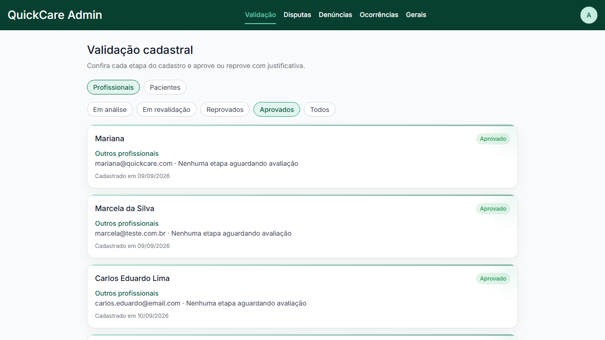
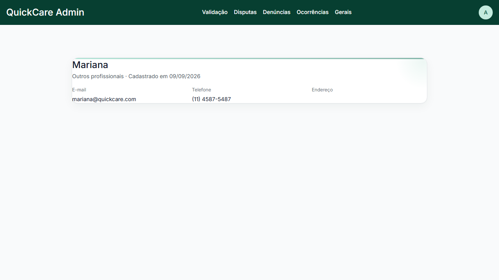
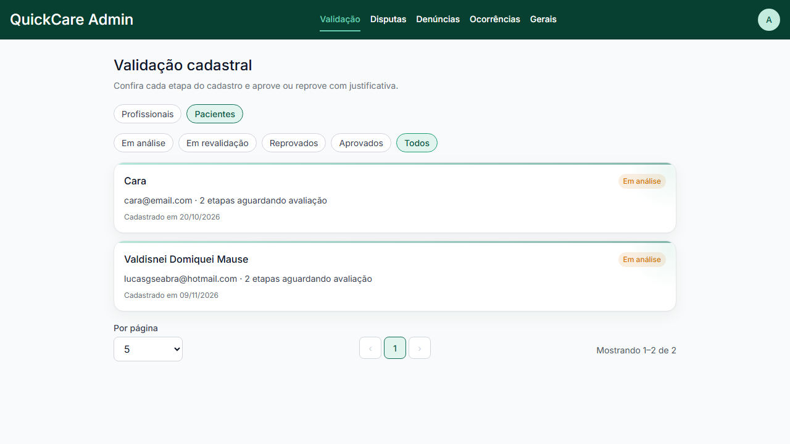
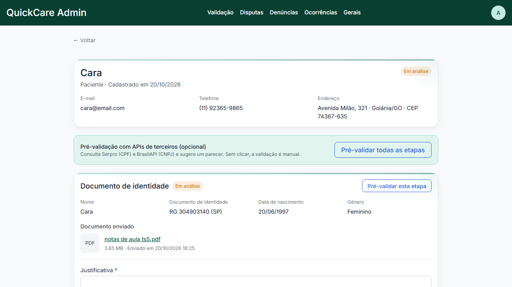

# Relatório de Execução de Testes End-to-End (E2E) — Teste 18

## 1. Identificação e Metadados da Execução

| Campo | Detalhamento |
| :--- | :--- |
| **Suíte de Teste** | `18 - Admin: Fila e Dossiês de Validação Cadastral (@auth)` |
| **Arquivo de Especificação** | `e2e/tests/18-admin-fila-e-dossies-validacao.spec.ts` |
| **Data da Execução** | `16/11/2026` |
| **Horário de Início (BRT / UTC-3)** | `00:59:20` (`2026-11-16T03:59:20.196Z`) |
| **Horário de Término (BRT / UTC-3)** | `00:59:42` (`2026-11-16T03:59:42.176Z`) |
| **Duração Total da Bateria** | `21,98 s` (`21.981 ms`) |
| **Ambiente Alvo** | `https://quickcare-frontend.vercel.app` · API `https://quickcare-backend-b4a4.onrender.com` |
| **Motor / Resolução** | Playwright + TypeScript · `chromium-remote` (`1280x720`) · `pt-BR` |
| **Branch Git** | `test/e2e-playwright` |
| **Responsável / Autoria** | Yasmin Feliciano Pereira Serafim de Lima |

---

## 2. Resumo Executivo dos Resultados

| Métrica | Quantidade / Valor |
| :--- | :---: |
| **Total de Casos de Teste Executados** | `2` |
| **Total de Subetapas Auditadas (`test.step`)** | `2` |
| **Aprovados (`PASSED`)** | `2` |
| **Reprovados / Ignorados** | `0` |
| **Capturas de Evidência Geradas (`.png`)** | `4` |
| **Taxa de Aprovação** | **100%** |

---

## 3. Quadro Analítico dos Casos de Teste

| ID | Caso de Teste | Passos Executados | Resultado Obtido | Tempo | Status |
| :--- | :--- | :--- | :--- | :---: | :---: |
| **CT-E2E-18.1** | deve filtrar cadastros de Profissionais por situação e abrir o dossiê completo em /admin/profissionais/:id | 1. Autenticar Administrador, filtrar Profissionais Aprovados e abrir primeiro dossiê (`11.562 ms`) | Validações concluídas com êxito sem divergências | `12,21 s` (`12.212 ms`) | **APROVADO** |
| **CT-E2E-18.2** | deve alternar para a fila de Pacientes e inspecionar um dossiê em /admin/pacientes/:id | 1. Selecionar filtro Pacientes -> Todos e abrir dossiê /admin/pacientes/:id (`7.609 ms`) | Validações concluídas com êxito sem divergências | `7,79 s` (`7.793 ms`) | **APROVADO** |

---

## 4. Evidências Visuais Capturadas Automaticamente

### CT-E2E-18.1 — deve filtrar cadastros de Profissionais por situação e abrir o dossiê completo em /admin/profissionais/:id

#### Fila de Validação cadastral filtrando Profissionais com situação Aprovados

#### Dossiê administrativo de Profissional exibindo metadados, atuações e histórico de documentos

### CT-E2E-18.2 — deve alternar para a fila de Pacientes e inspecionar um dossiê em /admin/pacientes/:id

#### Fila administrativa alternada para o perfil Pacientes listando todos os cadastros

#### Dossiê administrativo de Paciente com etapas de CPF e documento de identidade

---

## 5. Artefatos Complementares
- **Relatório HTML:** `./html-report/index.html` (`npm run report:18`)
- **Log JSON:** `./resultado-execucao.json`
