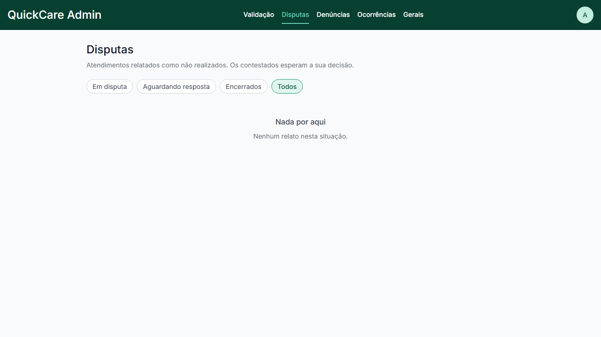
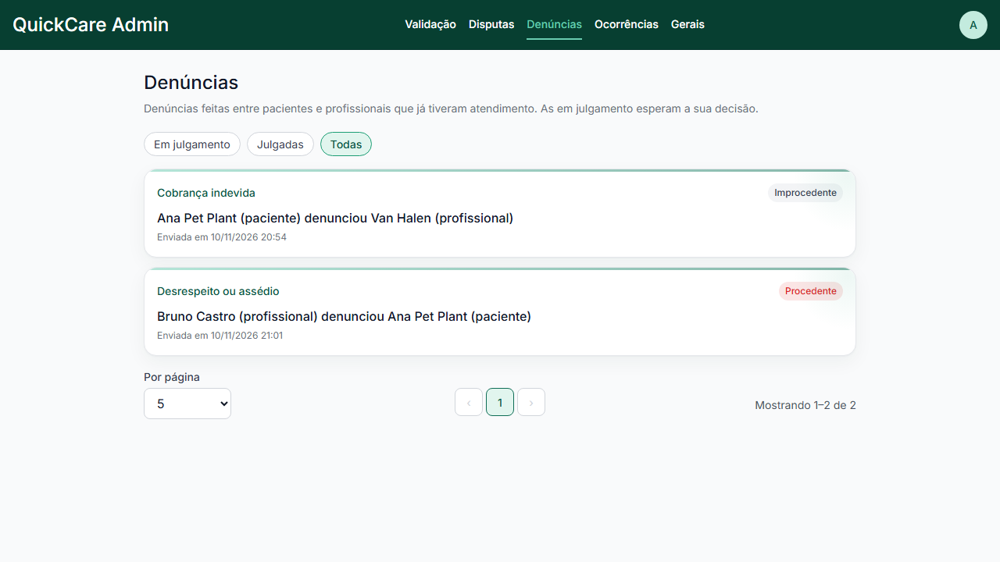
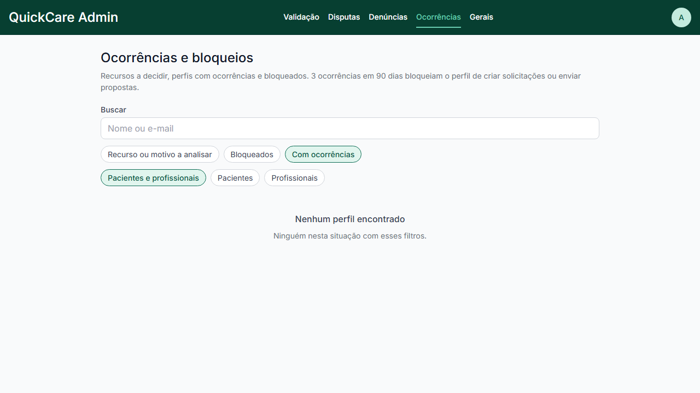

# Relatório de Execução de Testes End-to-End (E2E) — Teste 19

## 1. Identificação e Metadados da Execução

| Campo | Detalhamento |
| :--- | :--- |
| **Suíte de Teste** | `19 - Admin: Mediação e Disciplina (Disputas, Denúncias e Ocorrências) (@auth)` |
| **Arquivo de Especificação** | `e2e/tests/19-admin-disputas-denuncias-ocorrencias.spec.ts` |
| **Data da Execução** | `16/11/2026` |
| **Horário de Início (BRT / UTC-3)** | `00:59:50` (`2026-11-16T03:59:50.761Z`) |
| **Horário de Término (BRT / UTC-3)** | `01:00:32` (`2026-11-16T04:00:32.219Z`) |
| **Duração Total da Bateria** | `41,46 s` (`41.459 ms`) |
| **Ambiente Alvo** | `https://quickcare-frontend.vercel.app` · API `https://quickcare-backend-b4a4.onrender.com` |
| **Motor / Resolução** | Playwright + TypeScript · `chromium-remote` (`1280x720`) · `pt-BR` |
| **Branch Git** | `test/e2e-playwright` |
| **Responsável / Autoria** | Yasmin Feliciano Pereira Serafim de Lima |

---

## 2. Resumo Executivo dos Resultados

| Métrica | Quantidade / Valor |
| :--- | :---: |
| **Total de Casos de Teste Executados** | `3` |
| **Total de Subetapas Auditadas (`test.step`)** | `3` |
| **Aprovados (`PASSED`)** | `3` |
| **Reprovados / Ignorados** | `0` |
| **Capturas de Evidência Geradas (`.png`)** | `3` |
| **Taxa de Aprovação** | **100%** |

---

## 3. Quadro Analítico dos Casos de Teste

| ID | Caso de Teste | Passos Executados | Resultado Obtido | Tempo | Status |
| :--- | :--- | :--- | :--- | :---: | :---: |
| **CT-E2E-19.1** | deve carregar o painel de Disputas (/admin/disputas) e alternar os filtros de situação | 1. Acessar /admin/disputas e verificar filtros e estados da fila (`6.843 ms`) | Validações concluídas com êxito sem divergências | `7,41 s` (`7.410 ms`) | **APROVADO** |
| **CT-E2E-19.2** | deve carregar o painel de Denúncias (/admin/denuncias) e alternar filtros de julgamento | 1. Acessar /admin/denuncias e interagir com filtros de situação (`7.030 ms`) | Validações concluídas com êxito sem divergências | `7,31 s` (`7.313 ms`) | **APROVADO** |
| **CT-E2E-19.3** | deve carregar Ocorrências e bloqueios (/admin/ocorrencias) com busca e filtros de recursos | 1. Acessar /admin/ocorrencias e validar controles de busca e situação disciplinar (`24.724 ms`) | Validações concluídas com êxito sem divergências | `24,96 s` (`24.959 ms`) | **APROVADO** |

---

## 4. Evidências Visuais Capturadas Automaticamente

### CT-E2E-19.1 — deve carregar o painel de Disputas (/admin/disputas) e alternar os filtros de situação

#### Módulo administrativo de Disputas carregado com filtros por situação do relato

### CT-E2E-19.2 — deve carregar o painel de Denúncias (/admin/denuncias) e alternar filtros de julgamento

#### Módulo administrativo de Denúncias carregado com filtros de acompanhamento e histórico

### CT-E2E-19.3 — deve carregar Ocorrências e bloqueios (/admin/ocorrencias) com busca e filtros de recursos

#### Módulo disciplinar de Ocorrências e bloqueios com regra de 3 ocorrências em 90 dias

---

## 5. Artefatos Complementares
- **Relatório HTML:** `./html-report/index.html` (`npm run report:19`)
- **Log JSON:** `./resultado-execucao.json`
