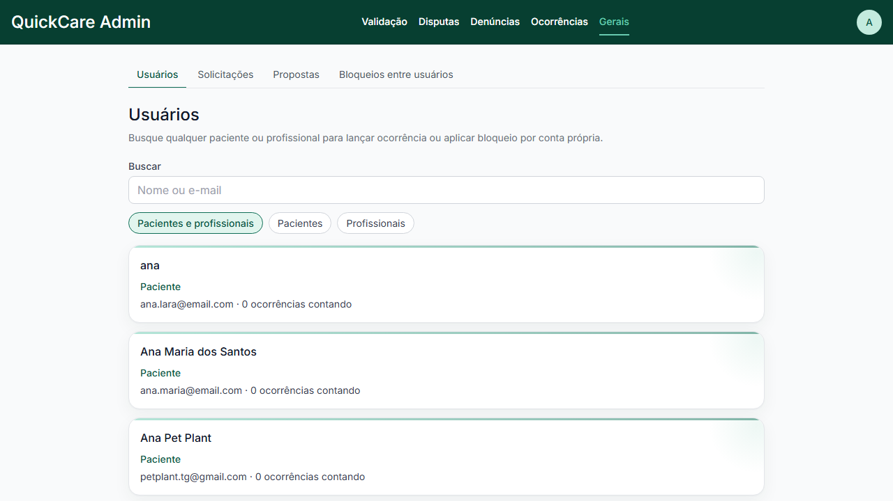
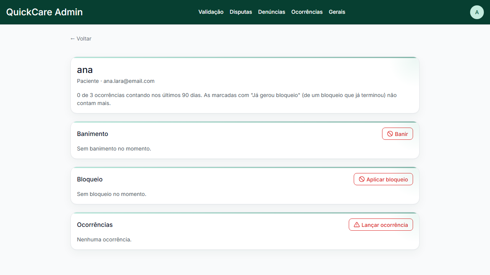
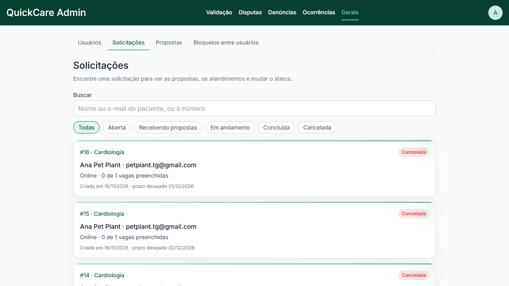
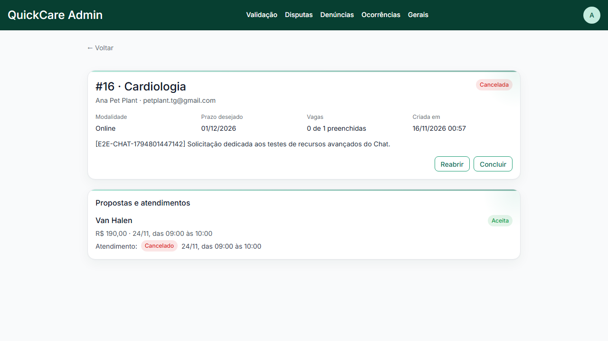
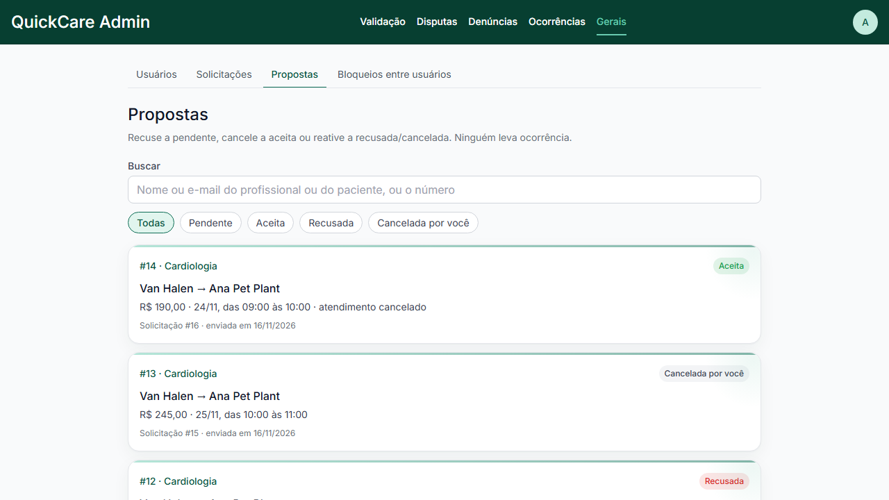
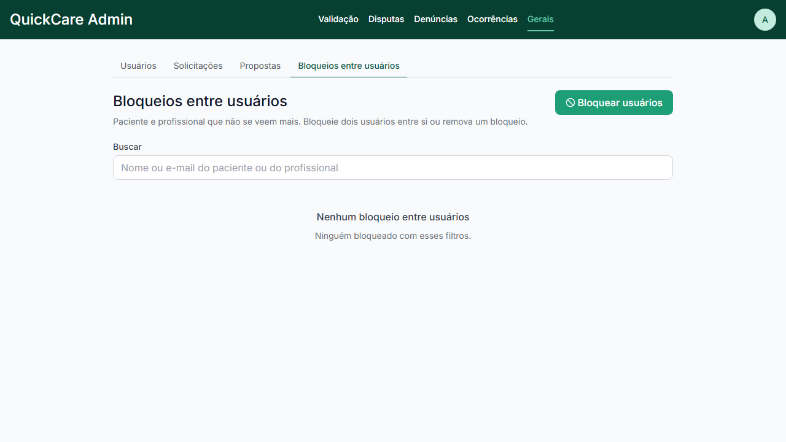

# Relatório de Execução de Testes End-to-End (E2E) — Teste 20

## 1. Identificação e Metadados da Execução

| Campo | Detalhamento |
| :--- | :--- |
| **Suíte de Teste** | `20 - Admin: Consultas Gerais de Auditoria (@auth)` |
| **Arquivo de Especificação** | `e2e/tests/20-admin-consultas-gerais-auditoria.spec.ts` |
| **Data da Execução** | `16/11/2026` |
| **Horário de Início (BRT / UTC-3)** | `01:00:40` (`2026-11-16T04:00:40.716Z`) |
| **Horário de Término (BRT / UTC-3)** | `01:01:38` (`2026-11-16T04:01:38.877Z`) |
| **Duração Total da Bateria** | `58,16 s` (`58.161 ms`) |
| **Ambiente Alvo** | `https://quickcare-frontend.vercel.app` · API `https://quickcare-backend-b4a4.onrender.com` |
| **Motor / Resolução** | Playwright + TypeScript · `chromium-remote` (`1280x720`) · `pt-BR` |
| **Branch Git** | `test/e2e-playwright` |
| **Responsável / Autoria** | Yasmin Feliciano Pereira Serafim de Lima |

---

## 2. Resumo Executivo dos Resultados

| Métrica | Quantidade / Valor |
| :--- | :---: |
| **Total de Casos de Teste Executados** | `3` |
| **Total de Subetapas Auditadas (`test.step`)** | `4` |
| **Aprovados (`PASSED`)** | `3` |
| **Reprovados / Ignorados** | `0` |
| **Capturas de Evidência Geradas (`.png`)** | `6` |
| **Taxa de Aprovação** | **100%** |

---

## 3. Quadro Analítico dos Casos de Teste

| ID | Caso de Teste | Passos Executados | Resultado Obtido | Tempo | Status |
| :--- | :--- | :--- | :--- | :---: | :---: |
| **CT-E2E-20.1** | deve listar Usuários em /admin/gerais/usuarios e inspecionar o detalhe disciplinar de um perfil | 1. Acessar /admin/gerais/usuarios e abrir ficha em /admin/perfis/:perfil/:id (`28.505 ms`) | Validações concluídas com êxito sem divergências | `29,02 s` (`29.020 ms`) | **APROVADO** |
| **CT-E2E-20.2** | deve auditar Solicitações em /admin/gerais/solicitacoes e abrir o detalhe administrativo da solicitação | 1. Acessar /admin/gerais/solicitacoes e abrir /admin/solicitacoes/:id (`13.210 ms`) | Validações concluídas com êxito sem divergências | `13,44 s` (`13.437 ms`) | **APROVADO** |
| **CT-E2E-20.3** | deve auditar Propostas em /admin/gerais/propostas e Bloqueios entre usuários em /admin/gerais/bloqueios-entre-usuarios | 1. Acessar /admin/gerais/propostas e validar listagem e filtros de propostas (`10.772 ms`) 2. Acessar /admin/gerais/bloqueios-entre-usuarios e verificar listagem e busca (`3.004 ms`) | Validações concluídas com êxito sem divergências | `14,04 s` (`14.045 ms`) | **APROVADO** |

---

## 4. Evidências Visuais Capturadas Automaticamente

### CT-E2E-20.1 — deve listar Usuários em /admin/gerais/usuarios e inspecionar o detalhe disciplinar de um perfil

#### Auditoria global de Usuários em /admin/gerais/usuarios listando pacientes e profissionais

#### Detalhe administrativo do perfil com histórico disciplinar e controles de governança

### CT-E2E-20.2 — deve auditar Solicitações em /admin/gerais/solicitacoes e abrir o detalhe administrativo da solicitação

#### Listagem global de Solicitações em /admin/gerais/solicitacoes com busca e filtros por status

#### Visão administrativa detalhada de uma solicitação com propostas e atendimentos vinculados

### CT-E2E-20.3 — deve auditar Propostas em /admin/gerais/propostas e Bloqueios entre usuários em /admin/gerais/bloqueios-entre-usuarios

#### Auditoria global de Propostas em /admin/gerais/propostas

#### Auditoria global de Bloqueios entre usuários em /admin/gerais/bloqueios-entre-usuarios

---

## 5. Artefatos Complementares
- **Relatório HTML:** `./html-report/index.html` (`npm run report:20`)
- **Log JSON:** `./resultado-execucao.json`
